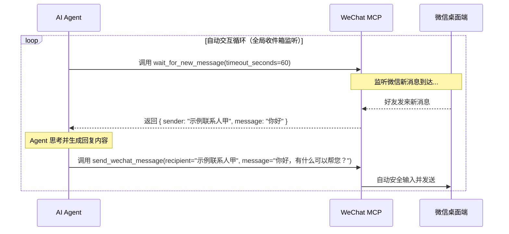

# WeChat MCP Server (Rust)

基于 Rust 编写的微信自动化 MCP (Model Context Protocol) 服务端，专为 macOS 桌面端设计。

通过 macOS 原生无障碍辅助（Accessibility）与系统事件（System Events）实现对微信桌面版的安全自动化控制，**零封号风险**，保护账号安全。

---

## 核心特性

- **安全无封号**：不注入动态库、不篡改内存、不触碰微信私有协议，完全基于系统级合法辅助操作。
- **保护用户剪贴板**：执行粘贴前自动暂存当前系统剪贴板，并在发送操作完成后自动恢复，不影响日常复制粘贴。
- **标准 MCP 协议**：严格遵循 Model Context Protocol 标准（JSON-RPC 2.0 over `stdio`），开箱即用于 Claude Desktop、Cursor、Antigravity 等各类 AI 客户端。
- **纯净高性能**：基于 Rust + Tokio 异步 I/O，极小二进制体积与内存占用。

---

## 提供的 MCP Tools

1. **`send_wechat_message`**
   - **描述**：向指定联系人、群聊或文件传输助手发送文本消息。
   - **参数**：
     - `recipient` (string)：接收人昵称、备注名或群聊名称（如：`文件传输助手`、`张三`、`技术交流群`）。
     - `message` (string)：要发送的文本内容。
2. **`focus_wechat`**
   - **描述**：激活并置顶显示微信窗口（自动校准归位至主屏标准坐标并切回聊天会话 Tab）。
3. **`get_recent_sessions`**
   - **描述**：扫描微信左侧会话列表，获取当前所有最近活跃会话（联系人/群名、最后发信时间、最新一条消息摘要）。
4. **`read_chat_messages`**
   - **描述**：读取指定联系人/群聊（或当前打开窗口）的最近真实聊天记录气泡（基于 macOS 原生离线 Vision OCR，毫秒级响应，零封号风险）。
   - **参数**：
     - `recipient` (string, 可选)：目标联系人或群名称。留空则读取当前正处于前台激活的会话。
5. **`wait_for_new_message`**
   - **描述**：长轮询监听微信新消息，用于驱动 Agent 自动思考并回复闭环：
     - **全局收件箱模式（推荐）**：留空 `recipient`，自动监听所有好友/群聊。任何好友发来新消息时，自动捕获、打开其窗口并提取最新完整聊天内容返回。
     - **单目标模式**：传入 `recipient`，专门监听该好友/群聊的新增气泡。
   - **参数**：
     - `recipient` (string, 可选)：要监听的接收人昵称或群名称（留空即为全局监听）。
     - `timeout_seconds` (number, 可选)：最长等待秒数（默认 60 秒）。

---

### Agent 自动回复工作流

在支持循环/任务模式的 AI Agent 中，可通过以下链路实现全自动对话：



---

## 编译与构建

确保本地已安装 Rust（1.75+）：

```bash
# 编译 Release 版本
cargo build --release
```

编译生成的可执行文件位于：
`target/release/wechat-mcp`

---

## 接入配置指南

### 1. Claude Desktop 配置

编辑 Claude Desktop 配置文件（路径通常为 `~/Library/Application Support/Claude/claude_desktop_config.json`）：

```json
{
  "mcpServers": {
    "wechat": {
      "command": "/path/to/target/release/wechat-mcp"
    }
  }
}
```

### 2. Cursor 配置

在 Cursor 的 `Settings -> Features -> MCP Servers` 中添加：
- **Name**: `wechat`
- **Type**: `command`
- **Command**: `/path/to/target/release/wechat-mcp`

### 3. Antigravity 配置

在 MCP 配置中添加：

```json
{
  "mcpServers": {
    "wechat": {
      "command": "/path/to/target/release/wechat-mcp"
    }
  }
}
```

---

## macOS 权限说明

由于本工具通过 AppleScript 控制微信桌面端，首次触发操作时，macOS 系统可能会弹出权限请求提示：
1. **辅助功能 (Accessibility)**：前往 `系统设置 -> 隐私与安全性 -> 辅助功能`，确保调用该程序的宿主应用（如 终端 / Claude / Cursor）已获得勾选授权。
2. **自动化 (Automation)**：前往 `系统设置 -> 隐私与安全性 -> 自动化`，允许宿主应用控制 `System Events` 和 `WeChat`。
