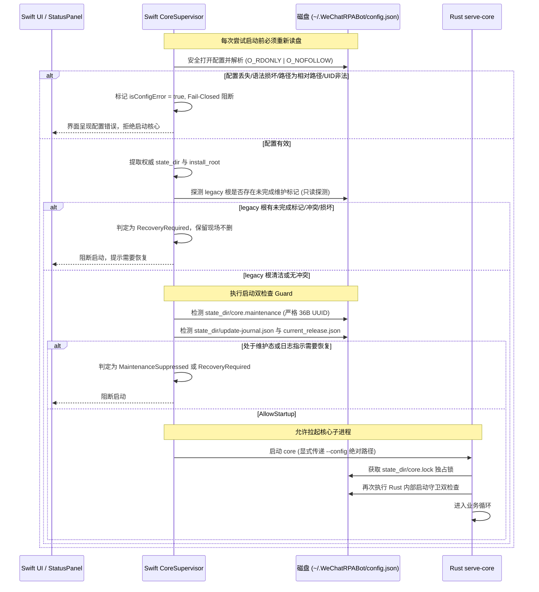

# 统一可信状态路径与安装根契约设计规范（经协调者裁定修正版）

- **日期**：2026-11-11
- **状态**：**经协调者裁定批准实施（msg_7105613d7c82），严守最小实现与先 RED 后 GREEN**
- **关联任务**：`task_9c3f4880893c` / `ctx_bd9b8fd6b076`
- **目标组件**：`BotConfig`、`CoreSupervisor.swift`、`src/core/serve.rs`、`src/core/control.rs`
- **前置基线**：Commit `3c75a07`（Swift 92 断言已全绿）

---

## 1. 事实纠偏与核心原则（依据协调者裁定）

1. **日志文件名事实纠偏**：
   - 经对齐核实：`src/updater/journal.rs`（第 121/146/1076 行）、`native/bootstrap/CoreSupervisor.swift`（第 266 行）、`src/core/control.rs` 测试（第 7371 行）当前实际**全量统一使用 `update-journal.json`（连字符）**；
   - 彻底废除此前的下划线改名提议，**严格保留 `update-journal.json` 既有事实**，不重命名现有文件。
2. **状态根合并，不新增独立状态配置**：
   - 更新状态文件与业务状态及核心锁统一归属于 `BotConfig.state_dir`；**严禁新增 `update_state_dir` 配置项**；
   - 核心物理分区严格分为两大根：**业务与更新统一状态根 (`state_dir`)** 与 **应用安装根 (`install_root`)**。
3. **保持单一权威记录现有契约**：
   - 严格保留现存的 `CurrentReleaseCommitRecord` 字段结构（`record_schema: 1`, `tx_id`, `release_id`, `sequence`, `channel`, `manifest_digest`, `installed_at`）；
   - **严禁发明任何未经评审的新字段**（如虚构的 `current` 或 `committed_at`）。
4. **旧 `~/.wechat-rpa` 历史标记只读安全探测**：
   - 当配置指向独立 `state_dir` 时，若旧 legacy 根（如 `~/.wechat-rpa`）中存在合法的未完成维护标记或损坏事务，绝不能因切换根而绕过维护阻断；
   - 系统仅执行**只读安全探测**：遇冲突或未知情况严格返回 `RecoveryRequired`，保留现场绝不删除，严禁盲目自动清理或自动迁移；
   - 单元与集成测试必须通过**显式注入 legacy 根参数**进行验证，严禁直接读写真实用户的 `$HOME`。
5. **Swift 启动前原子安全读取配置**：
   - 每次在 `CoreSupervisor.checkAndReconcile()` 启动任何核心进程前，直接从磁盘读取并解析配置文件；
   - 严禁依赖任何内存缓存或仅比对 mtime+size；配置变更若与运行中的核心冲突必须 Fail-Closed，严禁切根后误清旧维护标记。
6. **安装根严格受控 fd / UID 权限校验**：
   - `install_root` 必须是绝对路径；
   - 必须通过 `O_DIRECTORY | O_NOFOLLOW` 打开并校验 `st_uid == geteuid()`，严禁仅依靠 `canonicalize` 接受逃逸；
   - 配置为 `None` 时兼容空状态运行；一旦存在 `Committed` 更新记录，缺失 `install_root` 严格 Fail-Closed 阻断启动。
7. **消除 `update-status` 坏配置 Fallback**：
   - `src/core/control.rs` 中当配置加载失败时，直接返回错误退出码与标准错误，彻底移除 `base.join("state")` 的猜根兜底；
   - 保持已有 public JSON 字段结构与只读无副作用契约。

---

## 2. 状态根与安装根归属拓扑

```text
[配置文件: ~/.WeChatRPABot/config.json] (唯一权威真理源)
       │
       ├── state_dir (绝对路径, 0700, UID 校验) ──► [统一状态根 State Root]
       │                                         ├── history/ (history.sqlite3)
       │                                         ├── contacts/ (contacts.sqlite3)
       │                                         ├── sessions/, backups/
       │                                         ├── gateway.sqlite3
       │                                         ├── core.lock (核心独占互斥锁)
       │                                         ├── core.maintenance (严格 36 字节 UUID, 0600)
       │                                         ├── core.maintenance.json (结构化元数据)
       │                                         ├── update-journal.json (事务日志，连字符)
       │                                         ├── current_release.json (权威当前版本记录)
       │                                         ├── highest_accepted_sequence (单调增高水位)
       │                                         └── update.lock (更新独占事务锁)
       │
       └── install_root (可选绝对路径, 0755, UID 校验) ──► [应用安装根 Install Root]
                                                  ├── releases/ (版本不可变目录)
                                                  │     └── <release_id>/ (组件载荷)
                                                  └── current -> releases/<release_id> (符号链接)
```

---

## 3. Swift 宿主与 Rust 同源配置读取时序



---

## 4. 最小公共代码变更方案

### 4.1 `BotConfig` 变更 (`src/core/config.rs`)
- 在 `BotConfig` 结构体中新增可选字段：
  ```rust
  #[serde(default, skip_serializing_if = "Option::is_none")]
  pub install_root: Option<PathBuf>,
  ```
- 严格校验逻辑：
  - 若配置了 `install_root`，必须满足 `install_root.is_absolute()`，否则 `bail!("absolute install_root required")`；
  - 必须通过内核属性校验：不是逃逸的符号链接，且所有者 `st_uid == geteuid()`；
  - 缺省时保持 `None`，向后兼容 `schema_version = 1`。

### 4.2 启动接线 (`src/core/serve.rs`)
- 在生产启动构造 `StartupGuardPaths` 时：
  ```rust
  let (releases_dir, current_link) = match &config.install_root {
      Some(root) => (Some(root.join("releases")), Some(root.join("current"))),
      None => (None, None),
  };
  StartupGuardPaths {
      state_dir: config.state_dir.clone(),
      releases_dir,
      current_link,
  }
  ```
- 若 `install_root` 为 `None`，遇到已提交更新时仍保持现存的 Fail-Closed 行为；若配置了合法的 `install_root`，启动守卫通过对真实 `releases/` 与 `current` 的内核比对验证放行。

### 4.3 消除坏配置 Fallback (`src/core/control.rs`)
- 彻底移除 `match BotConfig::load(&config_path) { Ok(c) => c.state_dir, Err(_) => base.join("state") }`；
- 当配置加载失败时，直接返回错误，不创建亦不猜测任何目录，保证 Fail-Closed；
- 同步检查 `core.maintenance.json` 与 `core.maintenance`，保持纯只读。

### 4.4 Swift 宿主对齐 (`native/bootstrap/CoreSupervisor.swift`)
- 消除默认硬编码的 `~/.wechat-rpa` 猜根逻辑；
- 在启动前通过 `loadConfigFromDisk()` 读取与 Rust 相同的 `config.json`，提取权威的 `state_dir` 与可选的 `install_root`；
- 日志文件统一绑定为 `state_dir.appendingPathComponent("update-journal.json")`；
- 增加对显式注入 `legacyRootURL` 的只读冲突探测支持（仅用于隔离测试与迁移期双保险，生产默认探测时不删除旧文件）。

---

## 5. 先 RED 后 GREEN 实施顺序

1. **Step 1 (RED 测试先行)**：
   - 编写 `tests/trusted_paths_test.rs`：
     - 测试 1：`test_bot_config_install_root_absolute_validation`（相对路径被拒绝，绝对路径解析成功）；
     - 测试 2：`test_control_update_status_invalid_config_fails_closed`（配置损坏时 update-status 严格报错，不 fallback 猜根）；
     - 测试 3：`test_serve_core_startup_guard_with_configured_install_root`（配置了合法 install_root 时验证放行；未配置且 Committed 时 Fail-Closed 拦截）；
     - 测试 4：`test_legacy_state_maintenance_detected_without_deletion`（只读探测旧目录标记，遇未完成维护严格拦截且不删旧文件）。
   - 此时因功能未实现，测试呈现确定性 RED。
2. **Step 2 (GREEN 最小实现)**：
   - 修改 `src/core/config.rs`；
   - 修改 `src/core/serve.rs`；
   - 修改 `src/core/control.rs`；
   - 修改 `native/bootstrap/CoreSupervisor.swift`。
3. **Step 3 (全量验证)**：
   - 运行新测试，确认全 GREEN；
   - 运行全量 `cargo test --locked --bin wechat-mcp`（1007 项通过）；
   - 运行 Swift 92 与 Swift 103（全项通过）；
   - 运行 `cargo fmt`、`clippy` 与安全检查。
4. **Step 4 (提交与汇报)**：
   - 提交原子 commit，汇报实际测试结果与剩余边界（真实排空未实现）。
