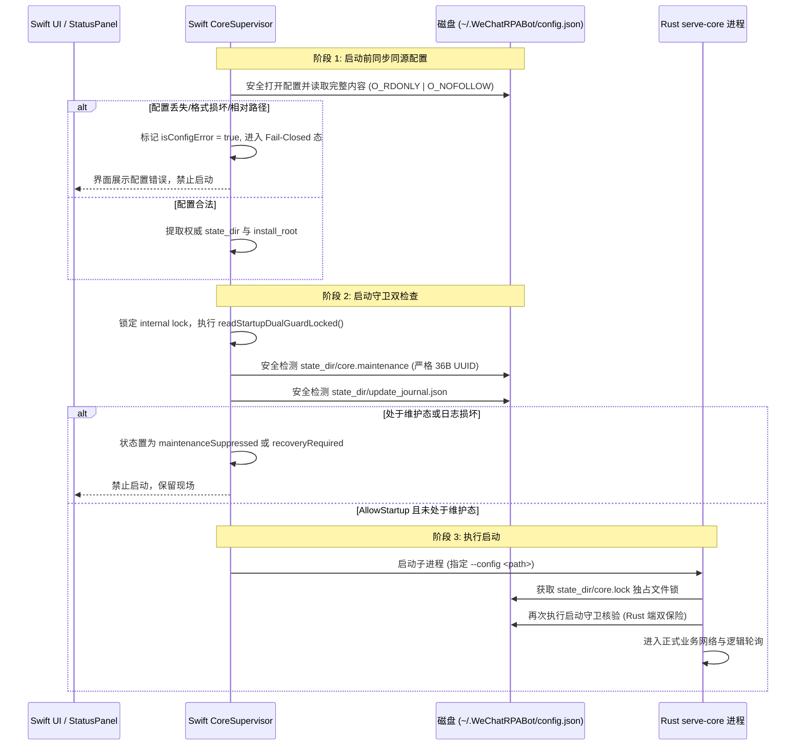

# 统一可信状态路径与安装根契约设计规范

- **日期**：2026-11-11
- **状态**：**待审方案（Design Only，先设计不实现，生产源码零修改）**
- **关联任务**：`task_9c3f4880893c` / `ctx_bd9b8fd6b076`
- **目标组件**：`BotConfig`、`CoreSupervisor.swift`、`src/core/serve.rs`、`src/core/control.rs`、`wechat-updater`
- **前置基线**：Commit `3c75a07`（已合入 `6ccf10a` 真实包与 CLI 只读对齐，Swift 92 断言全绿）

---

## 1. 现状痛点与第一性原理分析

当前系统跨 Rust 核心与 Swift 宿主存在四大“根路径”归属模糊、配置来源脱节与隐式推导缺陷：

1. **配置源脱节与 Swift 盲猜根**：
   - Rust 核心的权威业务路径由 `BotConfig.state_dir` 决定（要求绝对路径）；
   - Swift 端 `CoreSupervisor` 未实际解析 `config.json`，而是直接默认推导 `stateDir = home.appendingPathComponent(".wechat-rpa")`；
   - 一旦用户或测试通过自定义配置将 `state_dir` 挂载在非默认目录，Swift 监控的维护标志与 Rust 读写的维护标志将落在完全不同的文件系统位置，造成状态漂移。
2. **文件名命名历史分歧**：
   - Rust 端的事务日志为 `update_journal.json`（下划线）；
   - Swift `CoreSupervisor` 旧代码写为 `update-journal.json`（连字符）；
   - 若不统一契约，会导致一方写入提交记录而另一方无法察觉。
3. **安装 Root 生产未建模与硬编码 Fallback**：
   - Rust `BotConfig` 中缺失 `install_root` 建模，生产启动 `serve-core` 只能构造 `releases_dir: None, current_link: None`，遇到合法 `Committed` 更新时只能 Fail-Closed 判定 `unconfigured_production_install_root`；
   - `src/core/control.rs` 的 `update-status` 在配置加载失败时使用了 `base.join("state")` 的盲目 fallback，违反 Fail-Closed 原则。
4. **锁归属与进程互斥边界重叠**：
   - `core.lock` 保护核心运行与启动守卫核验；
   - `update.lock` 保护更新流程；两锁的落盘目录与互斥边界需要具备明确的唯一归属定义。

---

## 2. 四大根与锁的唯一归属契约

系统在物理文件系统上划分四类具有严格隔离边界的根路径与互斥锁：

```text
[配置文件: ~/.WeChatRPABot/config.json] (唯一真理源)
       │
       ├── state_dir ───────────────────► [业务状态根 State Root]
       │                                  ├── history/ (history.sqlite3)
       │                                  ├── contacts/ (contacts.sqlite3)
       │                                  ├── sessions/, backups/
       │                                  ├── gateway.sqlite3
       │                                  └── core.lock (核心独占运行锁)
       │
       ├── update_state_dir (默认同 state_dir) ► [更新事务状态根 Update State Root]
       │                                  ├── core.maintenance (严格 36 字节 UUID, 0600)
       │                                  ├── core.maintenance.json (结构化元数据)
       │                                  ├── update_journal.json (事务日志)
       │                                  ├── current_release.json (权威当前版本记录)
       │                                  ├── highest_accepted_sequence (单调增高水位)
       │                                  └── update.lock (更新独占事务锁)
       │
       └── install_root ────────────────► [应用安装根 Install Root]
                                          ├── releases/ (各版本只读不可变目录)
                                          │     └── <release_id>/ (展开的应用二进制与资源)
                                          ├── current -> releases/<release_id> (符号链接)
                                          ├── bin/ -> current/bin/ (入口二进制)
                                          └── Apps/ -> current/Apps/ (微信客服助手.app)
```

### 2.1 业务状态根 (State Root: `state_dir`)
- **归属**：核心运行期动态读写的一切用户业务数据。
- **强制规则**：
  - 必须由 `config.json` 的 `state_dir` 显式给出，且必须为绝对路径；
  - 目录权限必须为 `0700`，所有者必须为当前运行用户（`st_uid == geteuid()`）；
  - 严禁包含任何符号链接或挂载外部不受信目录；
  - 承载 `core.lock`：核心进程启动时在 `state_dir/core.lock` 获得独占文件锁，核心关闭或崩溃时内核自动释放。

### 2.2 更新事务状态根 (Update State Root)
- **归属**：更新生命周期权威状态与维护阻断凭证。
- **默认映射**：默认与 `state_dir` 处于同一私有安全目录，确保与业务状态具有相同的生命周期与备份归属。
- **文件全集与唯一权威规范**：
  1. `core.maintenance`：由排空/维护进程写入的严格 36 字节纯 ASCII 小写 UUID，权限 `0600`，由 `O_CREAT|O_EXCL` 原子生成；
  2. `core.maintenance.json`：结构化维护元数据（包含 `marker_schema: 1`, `tx_id`, `reason`, `timestamp`）；
  3. `update_journal.json`：**统一命名为下划线 `update_journal.json`**（彻底废弃 `update-journal.json`）；
  4. `current_release.json`：原子提交的单一权威版本记录（包含 release_id, sequence, manifest_digest, current 目标及 committed_at）；
  5. `highest_accepted_sequence`：记录系统单调递增高水位的序列号；
  6. `update.lock`：更新事务锁，更新 CLI 或执行器独占持有，防止并发更新写冲突。

### 2.3 应用安装根 (Install Root: `install_root`)
- **归属**：不可变的应用静态可执行文件与发布组件。
- **内部标准拓扑**：
  - `releases/`：受控目录，权限 `0755`，仅存放经检验通过的 `<release_id>` 子目录；
  - `current`：符号链接，其目标必须使用真实内核凭据验证：通过固定 `releases/` 的 root fd 相对 `openat` 打开预期的 `<release_id>`，校验其 `st_dev` 与 `st_ino` 与 `current` 解析目标的 `st_dev`、`st_ino` 严格相等，彻底杜绝中间软链逃逸；
  - `bin/wechat-mcp`：实际执行进程路径。
- **Fail-Closed 规则**：
  - 若 `install_root` 未配置，启动守卫允许空状态运行；但一旦存在 `Committed` 更新，守卫必须返回 `RecoveryRequired(unconfigured_production_install_root)` 拒绝启动；
  - 严禁从 `release` 目录相对路径“猜测”安装根，严禁从 `argv[0]` 逆向推导安装根。

---

## 3. Swift 宿主与 Rust 同源配置读取时序与互斥机制

为了保证 Swift 宿主不依赖过期的内存缓存、不盲猜目录，定义如下严格时序：



### 3.1 时序关键细节
1. **先读盘、不信内存**：`CoreSupervisor.checkAndReconcile()` 在每次尝试拉起核心进程前，必须直接读取配置文件真实内容（检查 `stat` 的 `mtime` 与文件大小，若变更则重新完整反序列化），严禁使用 UI 界面的内存缓存。
2. **同源配置绝对路径传递**：Swift 启动 Rust 核心子进程时，必须通过 `--config /absolute/path/to/config.json` 显式传入完整绝对路径，绝不依赖默认路径或环境变量。
3. **配置写入与互斥**：
   - 当 UI 修改配置时，必须写入临时文件 `config.json.tmp.<uuid>`，通过 `fsync` 确保数据与目录落盘后，通过 `atomic rename` 覆盖目标配置；
   - 在处于更新维护期间（`maintenance_active == true`），UI 必须禁用关键路径配置修改（锁定 `state_dir` 与 `install_root` 输入框），防止更新流程中路径被动态篡改。

---

## 4. 最小 Public 配置变更与兼容迁移策略

### 4.1 `BotConfig` 契约扩充（向后兼容方案）

在 `src/core/config.rs` 中为 `BotConfig` 增加可选的 `install_root`：

```rust
pub struct BotConfig {
    pub schema_version: u32,
    pub host: String,
    pub account_id: String,
    pub allowlist: Vec<AllowlistEntry>,
    #[serde(skip_serializing_if = "Option::is_none")]
    pub ignorelist: Option<Vec<AllowlistEntry>>,
    pub state_dir: PathBuf,
    /// 新增可选字段：更新安装根目录（包含 releases/ 与 current/）
    #[serde(default, skip_serializing_if = "Option::is_none")]
    pub install_root: Option<PathBuf>,
    // 其余现有字段保持不变...
}
```

- **验证逻辑**：
  - 若 `install_root` 缺省（`None`），保持旧版兼容；若存在则强制要求绝对路径 `install_root.is_absolute()`，否则配置校验返回 `bail!("absolute install_root required")`；
  - 解析时将 `install_root` 转换为标准化的 canonical 路径或保证父路径无符号链接逃逸。

### 4.2 兼容迁移与旧路径残留处理原则
1. **严禁自动盲清旧目录**：
   - 若旧部署在 `~/.wechat-rpa/` 存在历史文件，而新配置指定了其他 `state_dir`，**绝不进行自动物理删除**（防止误删历史备份或日志）；
   - 系统仅对配置所指定的有效 `state_dir` 和 `install_root` 进行状态核验与管理。
2. **旧日志文件名无缝兼容**：
   - 权威文件定义为 `update_journal.json`；
   - 若读取时 `update_journal.json` 不存在但发现 `update-journal.json`，按如下策略处理：
     - 若 `update-journal.json` 内容合法，只读模式下发出迁移告警并兼容读取；更新进程在启动维护时，原子将其更名为 `update_journal.json`；
     - 若包含不合法或损坏内容，严格 Fail-Closed 标记 `RecoveryRequired`。

---

## 5. 隔离 RED 集成验收测试设计

为验证该可信路径契约在无任何副作用的前提下达成确定性收敛，设计以下 5 项隔离 RED 集成验收用例：

| 用例编号 | 测试名称 | 验证场景与故障注入 | 预期确定性断言 |
|:---:|---|---|---|
| **RED-P1** | `test_swift_rust_shared_temp_config_parity` | 在临时目录中生成包含 `state_dir` 与 `install_root` 的测试配置，分别启动 Swift `CoreSupervisor` 与 Rust 启动 Guard 模块读取该配置。 | 两者读取到的 `state_dir`、`maintenanceURL`、`journalURL` 与 `install_root` 路径完全精确一致，双检查决策完全一致。 |
| **RED-P2** | `test_corrupt_or_relative_config_fail_closed` | 故意配置相对路径 `state_dir: "relative/path"`，或破坏 `config.json` 语法。 | Swift 端 `isConfigError` 置为 `true` 拒绝启动；Rust 端返回明确的 `Err` 且进程退出码为 2，不产生任何副作用。 |
| **RED-P3** | `test_committed_journal_without_install_root_blocked` | 存在合法的 `Committed` 事务日志，但配置文件中 `install_root` 为 `None`。 | Swift 与 Rust 启动 Guard 均严格返回 `RecoveryRequired(unconfigured_production_install_root)` 并阻断启动。 |
| **RED-P4** | `test_install_root_symlink_escape_rejected` | 将 `install_root/current` 指向受控 `releases/` 外部的恶意伪造目录（诱导版本逃逸）。 | `verifyCurrentLinkTarget` 内核 `inode` 比对失败，启动 Guard 严格判定为非安全版本并阻断启动。 |
| **RED-P5** | `test_stale_legacy_paths_ignored_without_deletion` | 制造旧目录 `~/.wechat-rpa` 残留文件，但当前配置指向独立 temp 目录。 | 系统完全在 temp 目录闭环运行，旧目录文件完好无损，零意外删除。 |

---

## 6. 精确修改文件清单预估（待批准后实施）

- `docs/design/2026-11-11-trusted-update-paths.md`：本设计规范（当前产出）；
- `src/core/config.rs`：在 `BotConfig` 中新增 `install_root: Option<PathBuf>` 及其反序列化绝对路径校验；
- `native/bootstrap/CoreSupervisor.swift`：
  - 新增 `loadConfigFromURL(configURL)` 解析逻辑，使 `state_dir` 与 `install_root` 从配置动态驱动；
  - 废弃默认写死的 `~/.wechat-rpa` 猜测；
  - 统一事务日志名称为 `update_journal.json`；
- `src/core/control.rs`：消除 `update-status` 中的 `base.join("state")` 盲目 fallback，配置损坏时严格 Fail-Closed；
- `src/core/serve.rs`：生产启动时若配置了 `install_root`，通过 `StartupGuardPaths::with_install_root` 自动注入，消除未配置更新根拦截；
- `tests/trusted_paths_integration.rs`：新增上述 RED-P1 ~ RED-P5 隔离集成测试。

---

## 7. 审查与裁定提请

本规范严格遵循先设计后实现的原则，未改动任何生产代码。现向协调者提交裁定：
1. 是否批准在 `BotConfig` 中新增可选的 `install_root: Option<PathBuf>` 并在 Swift `CoreSupervisor` 中实现同源解析与统一路径注入？
2. 是否批准事务日志文件名统一规范为 `update_journal.json` 并消除 `control.rs` 中的未配置 fallback？
