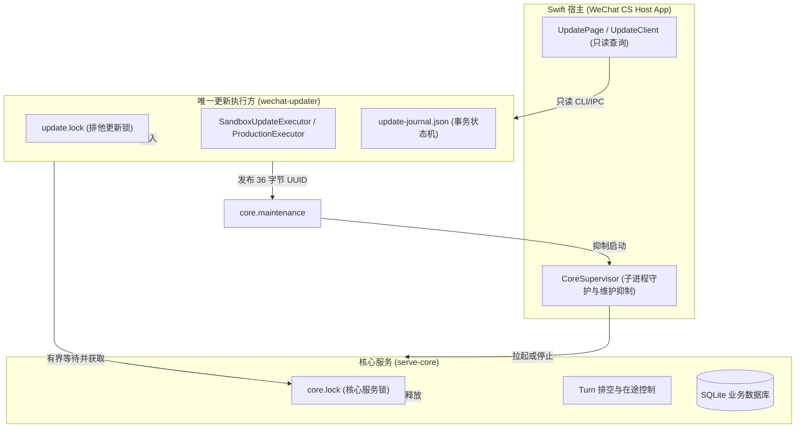
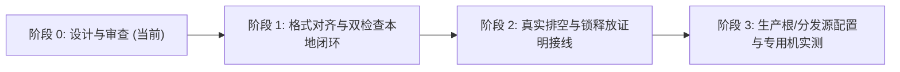

# 2026-11-11 更新运行时接线契约设计与安全实施规范

- **文档标识**：`docs/design/2026-11-11-update-runtime-contract.md`
- **日期**：2026-11-11
- **基线提交**：`f0c9ecf`（分支 `work/update-runtime-contract`）
- **状态**：运行时接线架构设计与可审查方案（只设计，待 Tech Lead / 协调者审查批准，未放行生产修改）

---

## 1. 概述与核心目标

当前 `wechat-mcp` 项目已在 U1 阶段完成了受限解码、规范化封套验签、防降级高水位检查、原子提交协议顺序重构（Commit `883cb5f`）以及进程组回收/孤儿管道防挂死（Commit `90918b5`）等核心隔离沙箱机制，全部 24 项沙箱测试均在本地验证通过。

然而，在生产环境下：
1. **生产信任根**尚未正式注入，CLI 处于严格 fail-closed 状态；
2. **下载分发源**（CDN、存储桶或版本服务器）尚未最终敲定；
3. **真实主动排空（Drain）**、跨进程停机退出、启动前双检查（Dual-check Guard）以及 launchd 重启协调等运行时接线仍未打通。

本设计文档的目标是**基于第一性原理，设计一套能安全实施和隔离验证的最小生产接线方案**：
- 严格遵循 KISS 原则，拒绝过度设计，优先复用现有 `CoreSupervisor`、`core.maintenance` 规范、`core.lock` 与 `UpdateJournal` 机制；
- 绝不把 UI 状态当作真实排空，建立基于内核级物理锁与进程退出的硬证据链；
- 明确划分「本地代码可完成」、「必须用户提供的生产信任根/分发/证书」与「必须专用机授权实测」三类边界，确保开发与测试资产与生产环境绝对隔离。

---

## 2. 系统架构拓扑与唯一执行方

### 2.1 参与组件与职责边界

系统由以下四个关键组件构成：
1. **Swift 宿主应用（WeChat CS Host App）**：用户图形操作界面与基础状态监测面板，负责通过只读接口查询更新状态、展示进度与向管理员提示更新，但**不直接执行版本切换或解包操作**。
2. **核心业务服务（`serve-core` / `wechat-mcp`）**：负责微信业务调度、对话轮次（Turns）流转、SQLite 业务库操作与 Worker 驱动。运行时持有 `state/core.lock`。
3. **CoreSupervisor（Swift 宿主内置守护机制）**：管理 `serve-core` 子进程的启停、退避重启与故障状态，监听 `core.maintenance` 文件并根据其内容决定是否抑制启动。
4. **独立更新器（`wechat-updater` 二进制）**：**系统更新事务的唯一执行方（Single Execution Authority）**。独立于宿主与 Core 运行，持有 `state/update.lock`，负责从解包、验签、重签名、排空协调、版本指针切换到候选自检的整个事务流。



### 2.2 唯一执行方原则与并发防御

1. **更新全局单例锁**：
   - 更新器启动的第一时间，必须获取 `state/update.lock`（文件描述符 `O_CREAT | O_RDWR` 并施加 `flock(LOCK_EX | LOCK_NB)`）。
   - 任何其他更新器实例若尝试启动，均会因无法获取锁而立即报错退出，彻底避免并发更新撕裂版本。
2. **状态机权威性**：
   - 事务阶段的推进、失败回滚和终态记录完全由更新器的 `update-journal.json` 主导，Swift 宿主仅作为状态消费者（Consumer），绝无权限越俎代庖去修改符号链接或清除日志。

---

## 3. 真实排空（Drain）与停机退出契约

### 3.1 为什么不能用 UI 状态代替真实排空
若仅靠 UI 将按钮变灰或将某个变量置为 false，底层的 `serve-core` 可能仍在处理正在进行的对话、向微信客户端发送点击或正处于 SQLite 事务中。强行切换可执行文件或强杀进程将导致：
- 微信消息发送中断或重复发送；
- 数据库事务损坏或 WAL 文件残留在未合并状态；
- 新旧组件二进制混跑。

### 3.2 核心服务排空三原则
核心服务 `serve-core` 必须支持平滑排空协议，严格遵循以下三条准则：
1. **停止接入新任务（Reject New Turns）**：
   - 当接收到排空信号时，核心服务立即进入 `Draining` 内部状态；
   - 外部 Brain、OpenAPI HTTP 接口及本地 Socket 立即拒绝新的 `next_turn` 请求，返回 `503 Service Unavailable / Maintenance`；
   - UI 提示“正在排空在途请求”。
2. **在途任务（In-flight Turns）状态明确与未知绝不重发**：
   - 对于正在等待大模型返回的在途任务，允许最多有界等待（例如 10 秒）；
   - **防重复发送红线**：若消息已经尝试通过 Worker 发送往微信界面，但未收到明确成功回报（状态为 `unknown`），**绝对禁止自动重发**，防止向真实客户造成骚扰甚至引发微信风控封号。排空结束时，在途状态持久化标记为 `drained_unknown`。
3. **排空超时严格放弃切换（Timeout Abort）**：
   - 排空总超时硬上限设为 30 秒；
   - 若 30 秒内在途任务仍未完成或子进程无法退出，排空失败，更新器**严格放弃版本切换**，事务回滚并保持旧版本运行，绝对禁止在排空未完成时强行切指针。

### 3.3 进程退出与锁释放证明（内核物理硬证据）
- 进程对象在内存中被置为 nil 或无法通过 PID 探测，均不能作为进程已退出的确凿证据。
- **排空与退出成功的唯一物理证明**：
  1. `serve-core` 正常退出后，内核会自动释放其持有的 `core.lock` 文件锁；
  2. 更新器调用 `acquire_core_lock_for_maintenance(&state_dir)`，**且实际成功获取到了 `core.lock` 的独占排他锁**；
  3. 持有该锁直到更新完成，保证在更新器操作期间没有任何外部力量可以意外启动 `serve-core`。

---

## 4. I4 维护格式与独立 Journal 启动前双检查

### 4.1 现有实现差异审计与格式统一

在现有代码基线中，存在如下关键格式分歧：
- **Swift `CoreSupervisor.swift` (I4)**：
  - 检查路径：`~/.wechat-rpa/core.maintenance`；
  - 校验规则：必须是**严格 36 字节的 ASCII UUID 字符串**，权限 `0600`，所属 UID 与当前用户一致；若大小不为 36、反序列化 UUID 失败或存在乱码，直接判定为 `recoveryRequired`，彻底锁死服务；
- **Rust `src/updater/journal.rs` (U1)**：
  - 当前写入了 `core.maintenance.json`（结构化 JSON），同时兼容写入 `core.maintenance`，但写入内容为任意 `reason` 字符串（如 `"updater draining"`）；
  - 这会导致 Swift Supervisor 读取后因不是 36 字节 UUID 而误判为 `recoveryRequired`！

**统一接线契约规范**：
1. `core.maintenance` 的内容**严格且仅允许包含 36 字符的标准 UUID 字符串**（即当前更新事务的 `tx_id` 中纯 UUID 部分，或符合 RFC 4122 的 36 字节 ASCII 字符串），末尾不带换行，文件大小严格等于 36 字节，文件权限严格设置为 `0600`。
2. 同目录下写入可选的辅助诊断文件 `core.maintenance.json`（权限 `0600`），记录详细上下文（包括 `tx_id`、`reason`、`timestamp`、`target_release_id` 等），供 UI 和日志做只读呈现，但**以纯文本 36 字节 `core.maintenance` 作为唯一互斥权威**。
3. 清除维护标志时，更新器必须校验 `core.maintenance` 中的 UUID 是否与当前 `tx_id` 精确一致；若不一致或文件损坏，严禁擅自删除，报错退出。

### 4.2 启动前双检查（Dual-check Guard）与 Fail-Closed 原则

任何组件（Swift 宿主、CoreSupervisor、`wechat-mcp` 自身）在启动执行任何业务前，必须执行启动前双检查：
1. **第一检查源**：`core.maintenance`
   - 不存在：表示无维护标志；
   - 存在且内容为合法 36 字节 UUID：处于维护抑制态；
   - 存在但格式损坏、大小不符、权限非 0600：触发 `recoveryRequired`。
2. **第二检查源**：`state/update-journal.json`
   - 不存在：表示无更新事务进行；
   - 存在且阶段为 `Committed` 或 `RolledBack`：事务已结，可正常清理；
   - 存在且阶段为 `Staged`、`PublisherVerified`、`LocalSigned`、`Draining`、`BackupVerified`、`Switching`、`CandidateTesting`、`CandidateTestingPassed`：事务尚未完成或处于崩溃恢复窗口；
   - 文件损坏、反序列化失败：触发 `recoveryRequired`。

**Fail-Closed 闭环规则**：
- 只要任一检查源出现异常或处于未完成状态，**严禁启动核心服务**；
- 若 `update-journal.json` 损坏，系统必须主动创建/保持 `core.maintenance` 标记，确保即使宿主崩溃重启，CoreSupervisor 也绝不会盲目拉起核心；
- 必须保持维护抑制态，直到管理员运行 `wechat-updater recover` 或执行显式的人工修复指令。

---

## 5. Updater 独立进程、父子身份校验与 Transaction 绑定

### 5.1 独立进程存活与生命周期
`wechat-updater` 作为独立的命令行二进制文件存在，存放于受控目录。它不依赖宿主 UI 进程的存活，在宿主退出或重启时能独立完成剩下的原子提交与维护清理。

### 5.2 安全启动约束与身份防伪造
为防止外部非授权进程滥用更新器修改系统，`wechat-updater` 实施严格的身份防伪造与 Transaction 绑定契约：
1. **命令行参数强制要求**：
   - `wechat-updater apply --config <path> --manifest <path> --tx-id <UUID>`
   - 启动时校验传入的 `--tx-id` 必须为有效 36 字节 UUID。
2. **父子进程关系与 UID 约束**：
   - `getuid()` 与 `geteuid()` 必须与配置文件和 state 目录拥有者完全一致，禁止跨用户提权；
   - 启动时通过环境变量 `WECHAT_CALLER_PID` 传递父进程 PID，并通过系统调用核实该 PID 属于同一用户，防止任意未知来源调用。
3. **Transaction 独占绑定**：
   - 更新器创建的 journal、维护文件 `core.maintenance` 以及候选测试证据中，必须全链路携带此 `tx_id`；
   - 若发现 state 目录下已存在属于其他 `tx_id` 的未完成事务，立即拒绝启动。

---

## 6. 完整应用版本包结构、Manifest Schema 与安装元数据

### 6.1 完整应用包目录形态（.App 与辅助组件）

在 macOS 生产环境下，完整应用支持以下组件的整体打包：
```text
wechat-mcp-release/
├── bin/
│   ├── wechat-mcp          # 核心服务 (0755)
│   ├── wechat-updater      # 独立更新器 (0755)
│   ├── wechat_bot_worker   # RPA 操作 Worker (0755)
│   ├── wechat_click        # 原生点击与窗口辅助 (0755)
│   └── desktop_helper      # 桌面辅助组件 (0755)
├── resources/
│   └── gateway.example.json
└── WeChatCS.app/           # Swift 宿主 UI 完整 Bundle (可选一体化分发)
    └── Contents/
        ├── Info.plist
        ├── MacOS/WeChatCS
        └── Resources/
```

### 6.2 发布清单 Manifest Schema v1 规范
复用已在 `production-updater-contract.md` 定义并通过验签测试的闭合 Schema：
- 严格携带 `release_id`、`sequence`、`channel`、`published_at`、`expires_at`；
- 目标约束：`target.os == "macos"`、`target.arch`（精确匹配 `arm64` 或 `x86_64`，禁止跨架构运行）；
- 资源硬上限：`max_unpacked_bytes`、`max_file_count`（防压缩炸弹）；
- 组件白名单：逐一列出相对路径、kind（`executable` / `regular_file`）、权限位（`0755` 或 `0644`）、SHA-256 与字节数，解包后禁止有多余或缺失文件。

### 6.3 严格顺序：验签 -> 本机重签名 -> 切换
所有文件操作必须严格遵守以下顺序：
1. **解包至独立暂存区**：`staging/<tx_id>/`（权限 `0700`），严禁直接解包到正式目录；
2. **发布者签名验证**：逐文件计算 SHA-256 并使用生产公钥根核验发布者 Ed25519 签名；
3. **本机 codesign 重签名**：
   - 仅对白名单中的可执行文件执行本机重签名；
   - 调用系统 `codesign --force --sign <Identity> ...`；
   - 紧接着执行 `codesign --verify --verbose=2` 验证签名有效性；
   - 若重签名失败，**全量销毁暂存区并终止事务**，现有稳定版本不受任何影响；
4. **原子发布到版本目录**：`rename(staging/<tx_id>, releases/<release_id>)`；
5. **切换版本指针**：排空与备份确认后，原子修改软链 `current -> releases/<release_id>`。

### 6.4 权威提交记录（Authoritative Commit Record）
版本的正式安装状态以 `state/current_release.json` 为单一权威事实源：
```json
{
  "record_schema": 1,
  "tx_id": "tx-88d447d2-749e-4e89-a5c3-1d89851148e6",
  "release_id": "0.2.0-20261110",
  "sequence": 1002,
  "channel": "stable",
  "manifest_digest": "6b3a...64hex",
  "installed_at": 1794300000
}
```
**原子落盘协议**：
- 候选自检通过后 -> 持久化 `CandidateTestingPassed` 到 journal -> 原子写入 `current_release.json`（写临时文件 -> fsync -> rename -> 父目录 fsync）-> 持久化 `Committed` 到 journal -> 清理 `core.maintenance`。
- 绝不将防降级高水位 `highest_accepted_sequence` 误当作已安装版本。

---

## 7. 候选自检（Candidate Testing）受信可执行约束

版本指针指向新版本后，在解除维护前必须进行候选自检，验证新版本能够在当前环境下正常工作：
1. **受信命令约束（No Arbitrary Shell）**：
   - 生产环境中**绝对禁止**外部传入任意 shell 命令；
   - 仅允许调用候选版本中硬编码的自检入口，例如：
     `releases/<release_id>/bin/wechat-mcp --check-config --config <path>`；
   - 执行前验证二进制路径为绝对路径且无路径穿越。
2. **自有进程组与全组回收机制（Setpgid & Group Kill）**：
   - 复用 Commit `90918b5` 已验证机制：通过 `libc::setpgid(0, 0)` 将子进程设置为独立进程组 leader；
   - 退出或超时时，使用 `kill(-pgid, SIGKILL)` 向进程组发送信号，彻底收割所有派生的子孙进程，杜绝孤儿进程长期占用系统资源。
3. **消除无界 Join 挂死与洪泛硬上限**：
   - 标准输出与标准错误读取设置单次缓冲上限（64 KB）与总读取硬上限（512 KB）；
   - 一旦超出硬上限，立即杀组报错，防止恶意或异常进程持续打印耗尽内存与 CPU；
   - 直接子进程退出后，短暂等待并在关闭写端后收割读线程，保证 `stdout_handle.join()` 在毫秒级安全返回。

---

## 8. 生产信任根编译、分发源策略与密钥轮换方案

### 8.1 生产公钥根与测试公钥完全隔离
- **红线规定**：测试夹具中的 `tests/fixtures/test_ed25519.key` 与合成公钥仅在 `#[cfg(test)]` 或测试适配器中可用，**绝对禁止**将测试公钥带入生产构建或作为默认根。
- **生产信任根注入模式**：
  在生产编译时，通过受控宏或静态结构体嵌入内置公钥表：
  ```rust
  pub static PRODUCTION_TRUSTED_KEYS: &[TrustedKeyEntry] = &[
      TrustedKeyEntry {
          key_id: "wechat-mcp-release-2026-v1",
          public_key_hex: "...", // 待用户提供的生产签名公钥 (32 bytes Ed25519)
          not_before: 1794297600,
          not_after: 1825833600,
          revoked: false,
      }
  ];
  ```
- 若编译时未配置生产信任根，运行时直接在 `update-check` 与 `apply` 前返回 `error: trust_root_unconfigured` 并退出码 1，保持安全的 Fail-Closed。

### 8.2 密钥轮换策略（Key Rotation）
1. **双根并存过渡期**：`TrustedKeyStore` 支持配置多个公钥条目；新老密钥更替时，系统可同时信任旧 Key 与新 Key；
2. **版本清单绑定 Key ID**：发布封套严格携带 `key_id`，客户端根据 `key_id` 匹配信任库中的具体条目，校验当前时间戳处于 `[not_before, not_after]` 范围内且未被吊销；
3. **紧急吊销（Revocation List）**：支持发布携带签名吊销凭据的更新，当检测到某个 Key ID 被标记为吊销后，立即拒绝任何该 Key 签发的后续安装包。

### 8.3 下载分发源方案审查选项（供协调者审定）

分发源尚未最终敲定，本设计提出以下三种可审查选项：
- **选项 A（推荐 - 静态安全存储桶）**：使用私有或受控 HTTPS 静态存储桶（如阿里云 OSS / 腾讯云 COS / AWS S3），开启只读与 HTTPS TLS 证书校验。客户端通过预设固定域名下载 Manifest 与 tar.gz。优点是无动态服务端漏洞风险，内容完全由签名封套保护。
- **选项 B（企业专有更新服务）**：自建专用轻量 API 服务，提供 `/v1/update/check` 和 `/v1/update/download`。支持根据客户端上报的当前版本、操作系统和架构精确下发最小增量说明。
- **选项 C（纯离线投放模式）**：适用于严格物理隔离的专用生产机器。不开放任何外网下载权限，仅支持管理员通过内部安全通道将已签名的 `release.tar.gz` 与 `manifest.json` 投放到本地目录后，执行 `wechat-updater apply --manifest <path>` 进行安装。

---

## 9. 数据不自动覆盖回退与灾难恢复（Disaster Recovery）

### 9.1 数据防覆盖红线
在更新失败执行回退时：
- 若系统存在业务数据库（如 SQLite 存储的聊天历史、好友关系、外部大脑对话）：
  - 一旦版本切换后（进入 `CandidateTesting` 阶段），即使自检失败，**严禁自动用更新前的备份数据库覆盖现有数据库**！
  - 原因：在版本切换与回滚的窗口期内，可能已有新的客户咨询消息写入数据库；盲目回滚覆盖将导致真实客户消息永久丢失，造成严重业务事故。
- **行为规范**：
  若数据库状态变为未知或已可能产生新数据，更新器将状态置为 `RecoveryRequired`，保持 `core.maintenance` 抑制标志，记录详细诊断日志，并向 UI 和 CLI 输出人工恢复指引。由管理员决定是合并数据还是手动恢复备份。

### 9.2 断电与崩溃精确全要素恢复
复用 Commit `883cb5f` 的全要素恢复契约：
当系统异常断电重启后，更新器读取 `update-journal.json` 与 `current_release.json`：
- 若处于 `CandidateTestingPassed` 状态且崩溃前已写入权威 record：全要素核对（`tx_id`、`release_id`、`sequence`、`manifest_digest`、`current` 指针及 Proof 证据）；只有当全部要素完全匹配时，才精确判定为 `CompletePendingCommit` 并完成收尾；
- 若要素有任一不匹配或序列号被篡改，严格拒绝自动恢复，返回 `ManualInterventionRequired`。

---

## 10. 主应用（Swift Host）与 Updater IPC 闭合协议

主应用（Swift Host）与更新器之间采用受限的 CLI 子进程与 JSON 协议进行闭合通信，杜绝开放任意动态脚本或未授权端口：

### 10.1 查询接口：`wechat-mcp control update-status`
- **调用方式**：`wechat-mcp control update-status --config <path>`
- **输出格式**：标准 JSON 输出（遵循 D2/I5 闭合字段），包含 `current_release`、`candidate_release`、`transaction`、`guard`；
- **错误语义**：退出码 0 代表成功获取；退出码非 0 代表配置读取或状态解析异常。

### 10.2 检查更新接口：`wechat-mcp control update-check`
- **调用方式**：`wechat-mcp control update-check --config <path> [--manifest <path>]`
- **输出格式**：
  - 发现可用版本：`{"status": "available", "candidate": {...}, "verification": {...}}`
  - 最新版本已安装：`{"status": "already_installed", ...}`
  - 架构或系统不兼容：`{"status": "incompatible", "reason": "...", "candidate": null}`
  - 生产公钥根未配置：`{"status": "incompatible", "reason": "trust_root_unconfigured", ...}`

### 10.3 幂等与取消语义（Idempotence & Cancellation）
- **幂等性**：针对同一 `tx_id` 重复调用 `apply`，更新器检查 journal 当前状态：若已在处理该事务，返回当前阶段与进度，严禁重复解包或并发冲突；若已被其他事务占用，返回 `conflict`。
- **取消语义（Cancel）**：
  - 仅在 `Staged`、`PublisherVerified`、`LocalSigned` 等尚未停机切换指针的早期准备阶段允许安全取消；取消后清理 `staging/` 暂存区并删除 journal；
  - 一旦进入 `Draining`、`Switching` 或 `CandidateTesting`，取消请求将被坚决拒绝，必须等待当前阶段收敛为提交或安全回滚，严禁在临界切换窗口强制终止更新器。

---

## 11. 实施分类清单（本地代码 / 用户提供 / 专用机实测）

为保证工程实施安全可控，清晰划分三类任务边界：

| 分类编号 | 分类名称 | 包含事项与范围界定 | 是否可在本工作区实现 |
|:---:|---|---|:---:|
| **分类 1** | **本地代码可完成**<br>*(Local Code)* | 1. `core.maintenance` 36 字节 UUID 格式双向对齐与解析加固；<br>2. 核心服务平滑排空逻辑（停止新 turn、在途 unknown 不重发、超时中断）；<br>3. 真实 `core.lock` 退出释放物理检测与获取适配；<br>4. 独立 `wechat-updater` 父子身份及参数校验接入；<br>5. 启动前双检查（Dual-check Guard）Fail-Closed 逻辑；<br>6. 单元测试、模拟故障注入与回归门禁。 | **是**<br>（纯代码与逻辑测试，无外部环境依赖） |
| **分类 2** | **必须用户提供的资产**<br>*(User Assets)* | 1. 生产环境 Ed25519 发布公钥（`public_key_hex`）与 Key ID；<br>2. 正式更新分发源（CDN 域名、存储桶鉴权策略或离线路径）；<br>3. 目标机器 codesign 重签名使用的钥匙串证书名称（Certificate Identity）。 | **否**<br>（涉及真实密钥与商业资产，必须由用户/管理员明确提供） |
| **分类 3** | **必须专用机授权实测**<br>*(Dedicated Machine)* | 1. macOS 系统钥匙串真实解锁与无交互重签名测试；<br>2. macOS TCC 辅助功能与屏幕录制权限授予实测；<br>3. 真实 launchd 守护任务（`gui/<uid>/local.wechat-mcp.host`）的 load / bootout / bootstrap 行为；<br>4. 真实微信登录状态下更新切换的无感验证。 | **否**<br>（本地沙箱环境无 macOS 专用机授权，严禁盲目执行） |

---

## 12. 允许修改的文件清单与分阶段实施路线图

### 12.1 允许修改的生产文件清单（待审批后进入开发）

在方案获得协调者明确批准前，**不改动任何生产文件**。获得批准后，仅允许在以下限定文件范围内小步推进：

1. **Rust 核心与更新器**：
   - `src/updater/journal.rs`：对齐 `core.maintenance` 36 字节 UUID 写入与清理规范；
   - `src/updater/executor.rs`：将沙箱适配器能力抽象提升为支持真实排空与锁检测的生产适配器接口；
   - `src/bin/wechat-updater.rs`：补全 `apply` / `rollback` / `recover` 的参数校验与执行流（在无生产根时安全 fail-closed）；
   - `src/core/serve.rs`：接线平滑排空协议（停止新请求、在途超时处理）；
   - `src/core/control.rs`：扩展状态与检查的深层排空标记解析。
2. **Swift 宿主与守护**：
   - `native/bootstrap/CoreSupervisor.swift`：对齐双检查逻辑与 `recoveryRequired` 安全边界；
   - `native/bootstrap/UpdatePage.swift`：仅用于呈现真实排空证据与只读反馈，保持写操作禁用。
3. **隔离测试文件**：
   - `tests/updater_tests.rs` / `src/updater/tests.rs`：补充排空在途不重发、UUID 双检查与真实锁竞争测试。

### 12.2 分阶段实施路线图



- **阶段 0（当前阶段）**：完成接线契约设计文档 `docs/design/2026-11-11-update-runtime-contract.md`，通过 Orca ask 向协调者提出明确方案与阻断点，严禁提前修改代码。
- **阶段 1（本地代码闭环）**：在获得批准后，修复 `core.maintenance` 格式不一致，实现 Rust 与 Swift 双端严格遵循 36 字节 UUID 契约，补齐启动前双检查测试。
- **阶段 2（真实排空与锁协议）**：实现 `serve-core` 停止新 turn、在途 unknown 不重发机制，将更新器与 `acquire_core_lock_for_maintenance` 真实退出证明接线。
- **阶段 3（生产资产注入与实测）**：用户提供生产根公钥与分发源后，配置生产编译宏，在具备 TCC 授权的专用机上进行实测。

---

## 13. RED-GREEN 验收标准与测试矩阵

实施接线必须遵循严格的 RED-GREEN TDD 规范，先写失败测试暴露缺陷，再完成最小实现：

| 测试用例名称 | 验证目标与断言要点 | 预期 RED 表现 | 预期 GREEN 表现 |
|---|---|---|---|
| `test_maintenance_marker_strict_36_bytes_uuid_contract` | 验证 Rust 写入的 `core.maintenance` 为严格 36 字节 UUID，Swift `readMaintenanceLocked()` 能够正常解析为 `.active` 而绝非 `.recoveryRequired`。 | 现实现写入 `reason` 导致 Swift 读取非 36 字节报 `recoveryRequired` | Swift 与 Rust 解析完全一致，`active(tx_id)` 双向通过 |
| `test_core_drain_rejects_new_turn_and_no_resend_on_unknown` | 模拟进入排空状态后：新 turn 立即被拒绝；在途状态为 unknown 的 turn 绝不触发重发逻辑。 | 排空标志未接线，新 turn 仍被接收处理 | 新 turn 返回 503 维护中，在途 unknown 标记沉淀为 `drained_unknown` |
| `test_core_drain_timeout_aborts_update_safely` | 模拟在途任务超过 30 秒无法排空，断言更新器放弃切换并安全退出，保持旧版本正常运行。 | 无超时中断逻辑，更新器强杀或强切版本 | 捕获排空超时，journal 记录 `DrainTimeout`，版本软链未发生变更 |
| `test_lock_release_proof_required_before_version_switch` | 模拟更新器在 `serve-core` 尚未释放 `core.lock` 时尝试切换版本，断言更新器拒绝切换并回滚。 | 仅依靠 PID 缓存判断，造成版本切换时锁冲突 | 更新器因无法获取 `core.lock` 排他锁而安全中止，杜绝并发竞争 |
| `test_dual_check_guard_fail_closed_on_corrupt_files` | 模拟 `core.maintenance` 或 `update-journal.json` 任一文件损坏/非合法 JSON，断言 CoreSupervisor 和 Core 均拒绝启动。 | 任一检查被绕过导致损坏状态下拉起核心 | 两端均严格返回 `recoveryRequired`，输出明确指引，启动保持抑制 |

---

## 14. 结论与下一步审查指引

本设计文档严格立足于现有代码事实，杜绝虚假声称已完成，明确了更新运行时接线的所有安全红线。
在协调者完成本契约设计审查并正式批准前，工作树保持干净，不引入任何破坏性代码变动。
