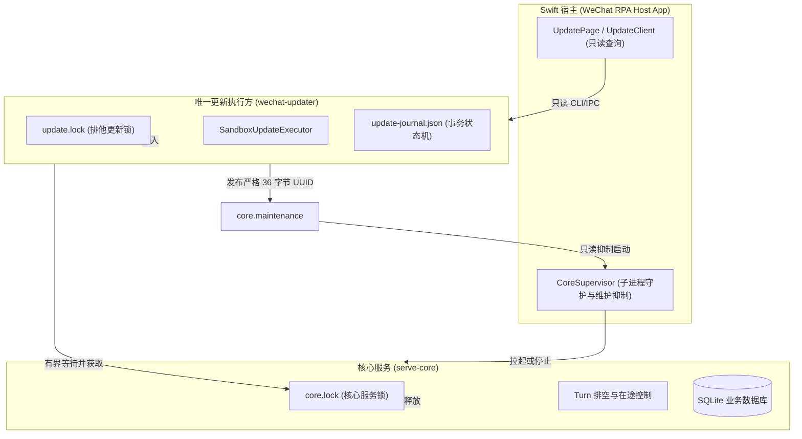

# 2026-11-11 更新运行时接线契约设计与安全实施规范

- **文档标识**：`docs/design/2026-11-11-update-runtime-contract.md`
- **日期**：2026-11-11（根据协调者意见修订版）
- **基线提交**：`758a07b`（分支 `work/update-runtime-contract`）
- **状态**：阶段 1 实施范围获批（仅限 36 字节 UUID 格式与 Rust/Swift 启动双检查只读 guard 及隔离测试；阶段 2 真实排空与生产变更暂不实施）

---

## 1. 概述与核心目标

当前 `wechat-mcp` 项目已在 U1 阶段完成了受限解码、规范化封套验签、防降级高水位检查、原子提交协议顺序重构（Commit `883cb5f`）以及自有进程组全组回收/孤儿管道防挂死（Commit `90918b5`）等核心隔离沙箱机制，全部 24 项沙箱测试均在本地验证通过。

针对协调者在审查提交 `758a07b` 时指出的事实与安全边界问题，本文档进行针对性修订：
1. **调用方身份与同 UID 威胁边界**：明确指出环境变量与同 UID 检查不是安全授权凭据；
2. **锁与排空证据界限**：明确 `core.lock` 仅代表 core 主进程未持锁，不能证明 worker 或副作用已退出；排空超时需保持抑制，不能承诺旧版安全恢复；
3. **启动双检查只读性与终态核验**：启动 guard 严格只读，未知/损坏/异常均 Fail-Closed，`Committed` 必须核验实际 record 与指针全要素；
4. **真实包与组件规范**：对齐已有契约 `production-updater-contract.md`，使用现有真实二进制（`wechat-mcp`、`wechat-updater`、`wechat_bot_worker`、`wechat_click`），严禁虚构组件；规范 tx UUID 映射；
5. **进程组与自检边界**：承认 `setpgid` 无法收割 `setsid` 逃逸进程；明确 `--check-config` 仅为配置静态语法校验，非应用级自检；
6. **验签顺序与 Codesign 区分**：验签必须在解包之前完成；重签名必须区分发布原始 hash 与本地签后 hash；阶段 1 保持生产操作 unsupported。

---

## 2. 系统架构拓扑与唯一执行方

### 2.1 参与组件与职责边界

系统由以下四个关键组件构成：
1. **Swift 宿主应用（WeChat RPA Host App）**：用户图形操作界面与基础状态监测面板，负责通过只读接口查询更新状态、展示进度与向管理员提示更新，**不直接执行版本切换或解包操作**。
2. **核心业务服务（`serve-core` / `wechat-mcp`）**：负责微信业务调度、对话轮次（Turns）流转、SQLite 业务库操作与 Worker 驱动。运行时持有 `state/core.lock`。
3. **CoreSupervisor（Swift 宿主内置守护机制）**：管理 `serve-core` 子进程的启停、退避重启与故障状态，监听 `core.maintenance` 文件并根据其内容决定是否抑制启动。
4. **独立更新器（`wechat-updater` 二进制）**：**系统更新事务的唯一执行方（Single Execution Authority）**。独立于宿主与 Core 运行，持有 `state/update.lock`，负责从封套验签、受控解包、排空协调、版本指针切换到候选自检的整个事务流。



### 2.2 唯一执行方原则与并发防御

1. **更新全局单例锁**：
   - 更新器启动的第一时间，必须获取 `state/update.lock`（文件描述符 `O_CREAT | O_RDWR` 并施加 `flock(LOCK_EX | LOCK_NB)`）。
   - 任何其他更新器实例若尝试启动，均会因无法获取锁而立即报错退出，彻底避免并发更新撕裂版本。
2. **状态机权威性**：
   - 事务阶段的推进、失败回滚和终态记录完全由更新器的 `update-journal.json` 主导，Swift 宿主仅作为状态消费者（Consumer），绝无权限越俎代庖去修改符号链接或清除日志。

---

## 3. 真实排空（Drain）与停机退出契约

### 3.1 为什么不能用 UI 状态代替真实排空
若仅靠 UI 将按钮变灰或将某个变量置为 false，底层的 `serve-core` 可能仍在处理正在进行的对话、向微信客户端发送点击或正处于 SQLite 事务中。强行切换可执行文件或强杀进程将导致微信消息异常与数据撕裂。

### 3.2 核心服务排空三原则
核心服务 `serve-core` 必须支持平滑排空协议，严格遵循以下三条准则：
1. **停止接入新任务（Reject New Turns）**：
   - 当接收到排空信号时，核心服务立即进入 `Draining` 内部状态；
   - 外部 Brain、OpenAPI HTTP 接口及本地 Socket 立即拒绝新的 `next_turn` 请求，返回 `503 Service Unavailable / Maintenance`；
   - UI 提示“正在排空在途请求”。
2. **在途任务（In-flight Turns）状态明确与未知绝不重发**：
   - 对于正在等待大模型返回的在途任务，允许最多有界等待（例如 10 秒）；
   - **防重复发送红线**：若消息已经尝试通过 Worker 发送往微信界面，但未收到明确成功回报（状态为 `unknown`），**绝对禁止自动重发**，防止向真实客户造成骚扰甚至引发微信风控封号。排空结束时，在途状态持久化标记为 `drained_unknown`。
3. **排空超时严格放弃切换（Timeout Abort）与不可信恢复**：
   - 排空总超时硬上限设为 30 秒；
   - 若 30 秒内在途任务仍未完成或子进程无法退出，更新器**严格放弃版本切换**；
   - **安全边界修正**：排空超时后必须保持维护抑制态（Fail-Closed），**绝对不能轻易承诺“旧版本已安全恢复”**，因为此时残余 worker 仍可能存活并产生并发冲突，需人工排查清理。

### 3.3 进程退出与锁释放证明（安全边界界定）
- **关于 `core.lock` 的严格安全边界界定**：
  - 成功获取 `core.lock` **仅证明遵守该锁的 `serve-core` 主进程当前未持有该锁**；
  - **`core.lock` 根本不能证明由 core 派生的 worker 进程（如 `wechat_bot_worker`、`wechat_click`）、孙进程或在途的系统硬件副作用已经退出或终止**！
- **排空退出的完整证据链要求**：
  1. `serve-core` 主进程退出释放 `core.lock`；
  2. 必须存在独立的 worker 退出证据（例如对 worker 进程的显式 waitpid、worker 专属互斥锁或进程监控表清空）；
  3. 更新器调用 `acquire_core_lock_for_maintenance(&state_dir)` 成功获取排他锁；
  4. 缺失上述任一证据时，更新器拒绝进行版本软链切换。

---

## 4. I4 维护格式与独立 Journal 启动前双检查

### 4.1 现有实现差异审计与格式统一

在现有代码基线中，存在如下关键格式分歧：
- **Swift `CoreSupervisor.swift` (I4)**：
  - 检查路径：`~/.wechat-rpa/core.maintenance`；
  - 校验规则：必须是**严格 36 字节的 ASCII UUID 字符串**，权限 `0600`，所属 UID 与当前用户一致；若大小不为 36、反序列化 UUID 失败或存在乱码，直接判定为 `recoveryRequired`，彻底锁死服务；
- **Rust `src/updater/journal.rs` (U1)**：
  - 当前写入了 `core.maintenance.json`（结构化 JSON），同时兼容写入 `core.maintenance`，但写入内容为任意 `reason` 字符串（如 `"updater draining"`）；
  - 这会导致 Swift Supervisor 读取后因不是 36 字节 UUID 而误判为 `recoveryRequired`！

**统一接线契约规范**：
1. **精确 UUID 映射**：
   - 事务标识 `tx_id` 统一格式为 `tx-<36-byte-uuid>`；
   - 写入 `core.maintenance` 标志时，**必须严格提取其中的 36 字节标准小写 UUID 字符串**（即去除 `tx-` 前缀，格式为 `8-4-4-4-12` 的 ASCII 字符），严禁写入任意 reason 字符串，严禁携带换行符，文件大小严格为 36 字节，权限为 `0600`。
2. 同目录下写入可选的辅助诊断文件 `core.maintenance.json`（权限 `0600`），记录详细上下文（包括 `tx_id`、`reason`、`timestamp`、`target_release_id` 等），供 UI 和日志做只读呈现，但**以纯文本 36 字节 `core.maintenance` 作为唯一互斥权威**。
3. 清除维护标志时，更新器必须校验 `core.maintenance` 中的 UUID 是否与当前 `tx_id` 剥离前缀后的 UUID 精确一致；若不一致或文件损坏，严禁擅自删除，报错退出。

### 4.2 启动前双检查（Dual-check Guard）严格只读与 Fail-Closed 闭环

任何组件（Swift 宿主、CoreSupervisor、`wechat-mcp` 自身）在启动执行任何业务前，必须执行启动前双检查。

**核心准则：启动 Guard 必须严格只读（Read-Only）**：
- 启动 Guard 严禁在检查期间因发现 journal 损坏或不存在而擅自创建新 UUID、写入文件或清理已有终态；
- 它的唯一职责是评估当前系统状态是否安全可启动。

**双检查核验流**：
1. **第一检查源**：`core.maintenance`
   - 不存在：无外部维护标志；
   - 存在且内容为合法 36 字节标准 UUID：处于维护抑制态（返回 `.active(uuid)`）；
   - 存在但格式损坏、大小不为 36、存在软链接、权限非 0600、UID 不符：判定为 `.recoveryRequired`。
2. **第二检查源**：`state/update-journal.json`
   - 不存在：表示无进行中的更新事务；
   - 存在且阶段为 `Staged`、`PublisherVerified`、`LocalSigned`、`Draining`、`BackupVerified`、`Switching`、`CandidateTesting`、`CandidateTestingPassed`：事务尚未完成或处于崩溃恢复窗口，判定为维护态；
   - 文件损坏、反序列化失败、存在未知 stage、为软链接、权限非 0600、UID 不符：判定为 `.recoveryRequired`；
   - **`Committed` 终态的全要素二次校验红线**：
     - **严禁仅凭 journal 中出现 `Committed` 标签就直接放行！**
     - 必须进一步只读核对：
       a. `state/current_release.json` 权威提交记录必须真实存在；
       b. 记录中的 `tx_id`、`release_id`、`sequence`、`manifest_digest` 必须与 journal 对应字段完全一致；
       c. `current` 软链接的目标目录名称必须等于该 `release_id`，且该目录真实存在为目录（非损坏链接）；
     - 若上述全要素任一不符，说明提交记录与文件系统脱节，**坚决判定为 `.recoveryRequired` 并抑制启动**。

**Fail-Closed 闭环**：
- 只要任一检查源指示处于未完成事务、数据损坏或不一致，**严禁启动核心服务**，保持抑制态待人工排查。

---

## 5. Updater 独立进程与调用安全边界

### 5.1 独立进程存活与生命周期
`wechat-updater` 作为独立的命令行二进制文件存在，存放于受控目录。它不依赖宿主 UI 进程的存活，在宿主退出或重启时能独立完成剩下的原子提交与维护清理。

### 5.2 调用方身份鉴权与同 UID 威胁边界（安全修正）
- **同 UID 威胁边界声明**：
  - 在 POSIX / macOS 语义中，环境变量（如 `WECHAT_CALLER_PID`）完全可在同 UID 下被任意派生子进程或同用户下的未受信脚本伪造；
  - `getuid()` 与 `geteuid()` 仅能证明调用方与运行方同属一个本地用户，**根本不能作为强安全凭据或鉴权依据**；
  - 不能假设同 UID 内的所有进程均完全受信。
- **阶段 1 与生产安全控制**：
  - 阶段 1 中，`wechat-updater` 保持生产写命令 `apply` / `rollback` / `recover` 处于 `unsupported`（退出码 1）；
  - 生产受控调用通道必须另行基于内核级 peer 凭据（如 Unix domain socket 的 `LOCAL_PEERPID` / `LOCAL_PEERCRED`）、受保护的 IPC 握手或系统级签名校验实现，不得在环境变量中传递未经证明的信任。

---

## 6. 完整应用版本包规范、Manifest Schema 与安装元数据

### 6.1 真实组件目录形态（基于已有契约，拒绝虚构）
严格引用已有契约 `production-updater-contract.md` 中的规范目录结构，严禁虚构不存在的 app bundle 或桌面辅助工具：
```text
wechat-mcp-release/
├── bin/
│   ├── wechat-mcp          # 核心服务 (0755)
│   ├── wechat-updater      # 独立更新器 (0755)
│   ├── wechat_bot_worker   # RPA 操作 Worker (0755)
│   └── wechat_click        # 原生点击与窗口辅助 (0755)
```

### 6.2 发布清单 Manifest Schema v1 规范
复用已在 `production-updater-contract.md` 定义并通过验签测试的闭合 Schema：
- 严格携带 `release_id`、`sequence`、`channel`、`published_at`、`expires_at`；
- 目标约束：`target.os == "macos"`、`target.arch`（精确匹配 `arm64` 或 `x86_64`，禁止跨架构运行）；
- 资源硬上限：`max_unpacked_bytes`、`max_file_count`（防压缩炸弹）；
- 组件白名单：逐一列出相对路径、kind（`executable` / `regular_file`）、权限位（`0755` 或 `0644`）、SHA-256 与字节数，解包后禁止有多余或缺失文件。

### 6.3 验签先于解包与 Codesign 变更后哈希区分（安全修正）
1. **验签先于解包（Verify Before Unpack）**：
   - 原始发布包解包前，必须首先在内存中对未解包的 `manifest` 签名封套及 `artifact` 压缩包整体 SHA-256 执行发布者 Ed25519 签名验证；
   - 验证通过前，**严禁创建任何解包目录或执行解压操作**，防止解压未签名的恶意压缩炸弹包。
2. **Codesign 前后哈希区分**：
   - 本机 codesign 重签名会直接修改 Mach-O 二进制文件的 `__LINKEDIT` 等段，导致重签后的二进制 SHA-256 与原始发布包不再相同；
   - 元数据中必须清晰区分：
     - `publisher_sha256`：发布者签名清单中对应的原始哈希；
     - `local_signed_sha256`：本机重签后的实际本地哈希；
   - 阶段 1 中不实现生产 codesign 重签名，保持其隔离验证特性。

---

## 7. 候选自检（Candidate Testing）受信可执行约束与边界

### 7.1 setpgid 逃逸边界（安全修正）
- **边界说明**：
  - Commit `90918b5` 中引入的 `libc::setpgid(0, 0)` 与全组 `kill(-pgid, SIGKILL)` 能够有效收割遵循标准 fork 的子孙进程并关闭管道；
  - **但它无法收割主动调用 `setsid()` 脱离原有进程组逃逸的恶意或特殊后代进程**；
  - 删除“彻底杜绝全部子孙孤儿”的绝对承诺，明确系统只能基于标准进程组隔离尽最大努力收割（Best-effort Group Cleanup）。

### 7.2 候选自检局限性与受信约束
- 候选自检命令严禁使用任意 shell；
- 命令如 `--check-config` **仅证明了静态配置文件的反序列化与字段合法性，根本不能代表完整的业务逻辑与应用级自检通过**；
- 完整的自检机制须待阶段 2/3 定义更完善的受限探针。

---

## 8. 实施分类清单（本地代码 / 用户提供 / 专用机实测）

| 分类编号 | 分类名称 | 包含事项与范围界定 | 是否可在本工作区实现 |
|:---:|---|---|:---:|
| **分类 1** | **本地代码可完成**<br>*(Local Code)* | 1. `core.maintenance` 36 字节 UUID 格式双向对齐与解析加固；<br>2. 启动前只读双检查（Dual-check Guard）Fail-Closed 逻辑（含 `Committed` 全要素验证）；<br>3. Rust 与 Swift 隔离单元测试。 | **是**<br>（阶段 1 实施范围） |
| **分类 2** | **必须用户提供的资产**<br>*(User Assets)* | 1. 生产环境 Ed25519 发布公钥（`public_key_hex`）与 Key ID；<br>2. 正式更新分发源（CDN 域名、存储桶鉴权策略或离线路径）；<br>3. 目标机器 codesign 重签名使用的钥匙串证书名称（Certificate Identity）。 | **否**<br>（阶段 1 不引入，保持 unsupported） |
| **分类 3** | **必须专用机授权实测**<br>*(Dedicated Machine)* | 1. macOS 系统钥匙串真实解锁与无交互重签名测试；<br>2. macOS TCC 辅助功能与屏幕录制权限授予实测；<br>3. 真实 launchd 守护任务的 load / bootout / bootstrap 行为；<br>4. 真实微信登录状态下更新切换的无感验证。 | **否**<br>（阶段 1 严禁执行） |

---

## 9. 阶段 1 实施范围与限定文件清单

依据协调者指令，本次**仅实施阶段 1**（仅维护 UUID 格式与 Rust/Swift 启动双检查，限定 journal/启动 guard/CoreSupervisor 及直接测试，避免 serve/control 业务改动与 Q2 冲突；阶段 2 真实排空暂不实施）：

### 允许修改的文件清单
1. **Rust 更新器与只读 Guard**：
   - `src/updater/journal.rs`：修改 `set_structured_maintenance_marker` 与 `clear_maintenance_for_tx`，使 `core.maintenance` 严格写入 36 字节小写 UUID，并新增只读双检查逻辑 `check_startup_guard_readonly`；
   - `src/updater/tests.rs`：新增/调整对应阶段 1 的隔离测试。
2. **Swift CoreSupervisor 守护**：
   - `native/bootstrap/CoreSupervisor.swift`：对齐只读双检查逻辑（引入 `checkStartupDualGuardReadonly`），支持在拉起前同时校验 `core.maintenance` 与 `update-journal.json`（含 `Committed` 全要素校验），保持 fail-closed。
3. **Swift 隔离测试**：
   - `tests/swift_host.rs` 或专有 Swift 测试用例：验证两端 36 字节 UUID 解析与双检查互通性。

### 严禁改动的文件
- `src/core/serve.rs`（避免与 Q2 冲突，不在此阶段实施）；
- `src/core/control.rs`（保持现有控制面稳定）；
- 不引入 Python，不触碰真实系统环境与钥匙串。
