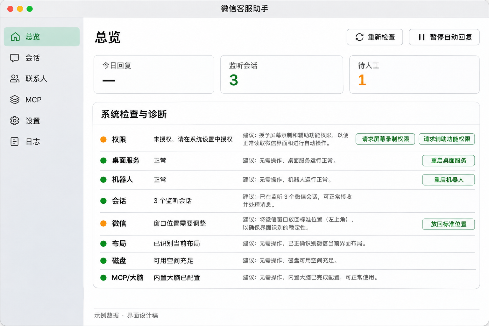
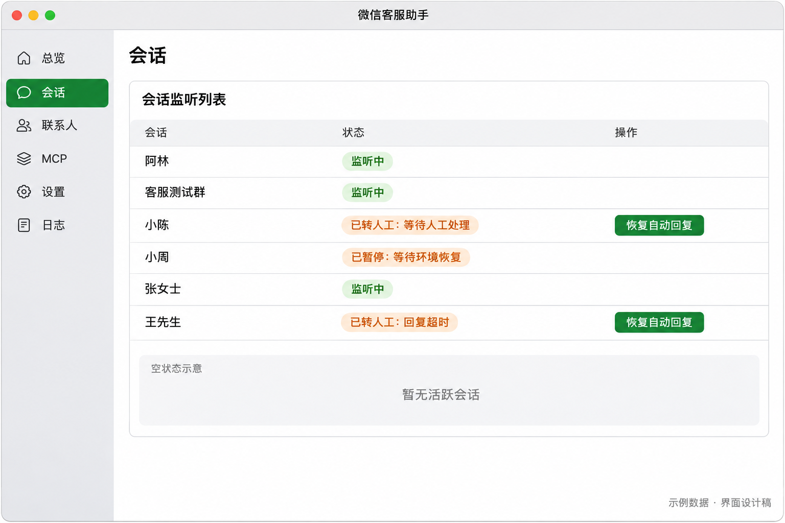
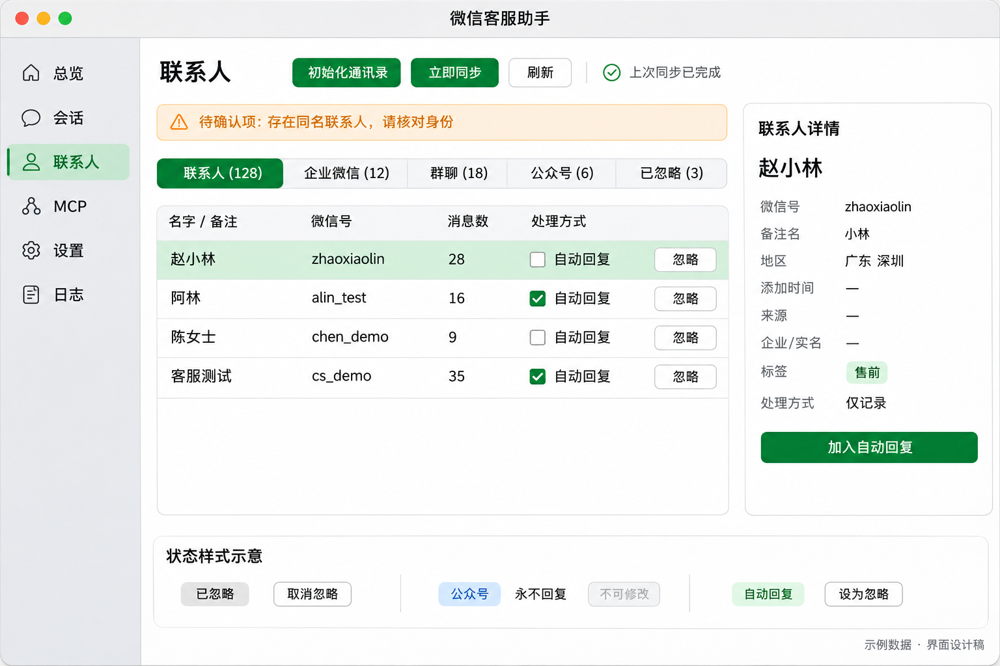
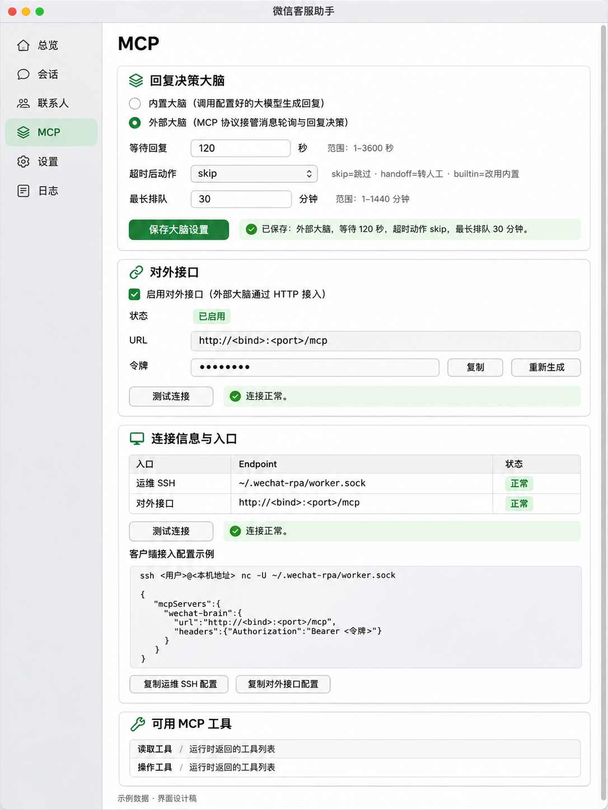
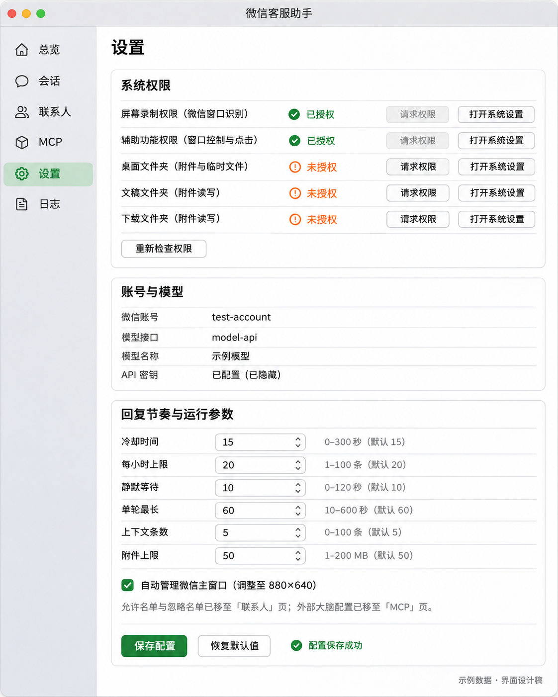
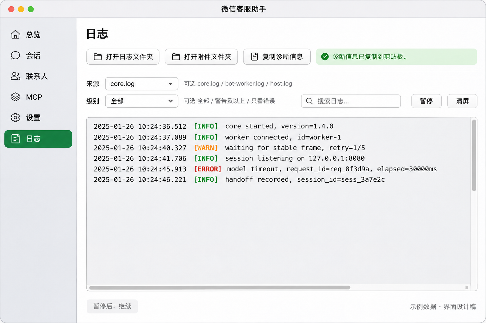

# 现有六页设计图

2026-11-14。按当前 native/bootstrap 源码核对，仅重排视觉；本组取代上一轮扩展功能的概念图作为现有功能改版依据。

使用内置 imagegen 生成。图内数据、日志、地址、模型和状态均为示例。可用 MCP 工具由运行时工具列表填充，图中不列虚构工具名。只读 URL 和令牌背景虽采用字段外观，实现时仍须保持只读。

空状态示意、状态样式示意、暂停后继续均为设计评审注释，不能作为常驻业务模块或额外操作。总览中的未授权与运行状态是独立视觉样例，不代表可运行组合；实现沿用真实权限门控。

| 页面 | 保留的现有功能 |
|---|---|
| 总览 | 三项指标、重新检查、全局暂停/恢复；八类诊断及权限请求、重启桌面服务、重启机器人、微信归位；重启确认对话框保留 |
| 会话 | 会话名称、现有状态及原因、转人工会话恢复自动回复、空列表提示；不新增筛选/聊天/主动接管 |
| 联系人 | 初始化通讯录及确认、立即同步、刷新、同步完整性、待确认提示、五类分类及计数、四列表格、八项详情、自动回复/忽略/取消忽略及公众号不可修改 |
| MCP | 内置/外部模式、三项外部参数及保存、接口启停、状态/URL/遮盖令牌、复制及令牌重生成确认、接口测试、端点状态及连接测试、SSH/HTTP 配置示例及两种复制、分组工具列表 |
| 设置 | 五项权限状态及请求/系统设置、权限复查、四项账号模型只读信息、六项参数及范围、管理窗口开关、说明、保存/恢复默认及结果反馈 |
| 日志 | 日志/附件文件夹、复制诊断及反馈、三个来源、三个级别、搜索、暂停/继续、清屏、只读日志及滚动 |

界面条件逻辑沿用源码：内置模式禁用外部参数；权限已授权时禁用请求按钮；联系人详情随所选行变更，已忽略/公众号动作不同；恢复默认先填表再保存；清屏只清当前日志显示；日志暂停不等于暂停机器人。

图片已逐页查看。未修改产品代码或进行真机交互验收。六图覆盖页面主体，条件状态和确认行为以本清单及源码为准。

## 总览

## 会话

## 联系人

## MCP

## 设置

## 日志

