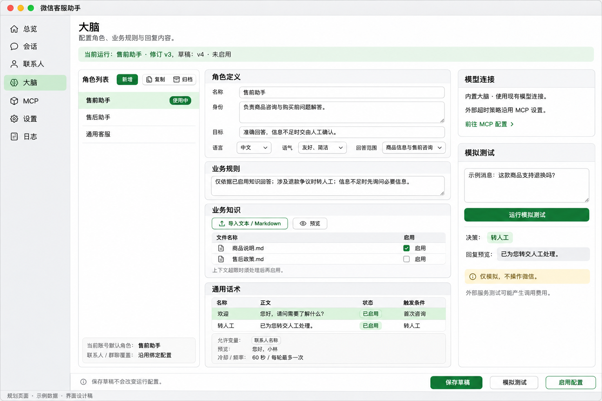
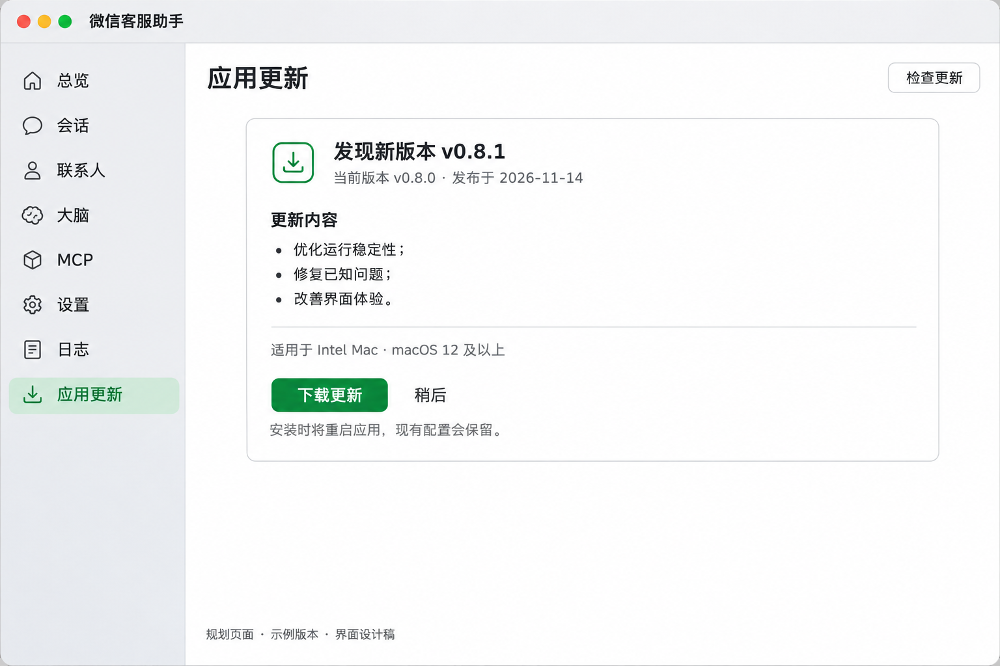
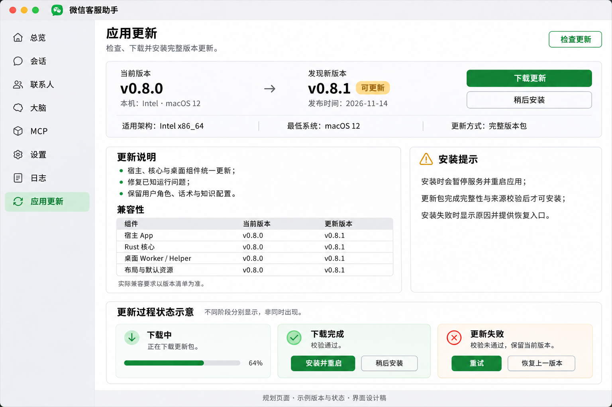

# 大脑与应用更新设计补图

2026-11-14。依据 docs/superpowers/plans/2026-11-10-production-brain-ui-and-app-update.md 既有规划，补充用户指定的两页。内置 imagegen 生成；不代表当前已实现。

## 大脑

提示词主题：原生浅色 macOS 客服工作台，角色列表、角色定义、业务规则、文本/Markdown 知识、通用话术、连接摘要、模拟测试、保存草稿与启用分离。连接字段唯一编辑来源仍为 MCP。草稿和运行修订明确区分。

## 应用更新

当前推荐：按用户要求简化为 v2。仅显示当前/可用版本、发布时间、更新说明、简短兼容要求、检查更新、下载更新和稍后。下载时原操作区替换为进度，校验通过后替换为安装并重启，失败时在原卡片内展示原因和适用的重试/恢复操作。保留更新能力，移除常驻组件版本表和并排状态示意。

内置 imagegen 提示词主题：原生浅色 macOS、八项导航、单一卡片、版本与更新内容、一个主按钮；不显示技术组件表、状态样例和多余提示面板。

以下为旧版留档：

提示词主题：原生浅色 macOS 工作台，当前及可用版本、发布时间、说明、兼容要求、统一组件版本、手动检查下载、安装重启、稍后安装、进度和失败恢复。

版本、角色、知识、状态均为示例。状态示意不是同时出现的业务模块。校验未通过时保留当前版本并允许重试，不应提供无意义的回退；图中“恢复上一版本”实际只适用于新版本已激活但启动失败且确实存在兼容旧版本的恢复状态。启用/测试/安装等行为需对应后端完成后接通。

这两页与 ../current-pages-v1/ 的六页合计八页。旧六页截图仍反映原有六项导航；最终实现统一为八项导航，并统一选中样式与图标，不按单张生成图中的细微差异实现。

本次仅设计图，未修改业务代码、运行更新或发送消息。
