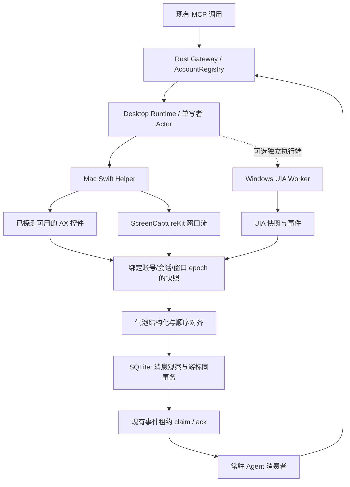
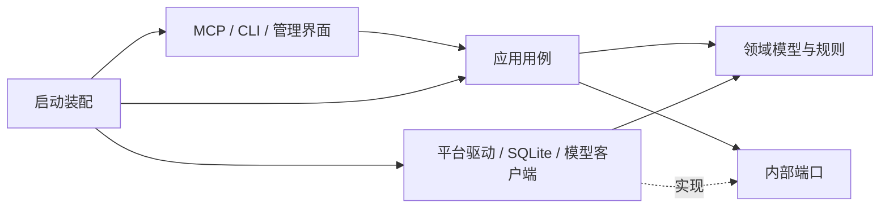

# 个人微信 RPA 深度研究与技术方案

研究日期：2026-10-27，Asia/Singapore。检索、远端源码读取和本机只读探测均在该日完成。

适用仓库：`/path/to/wechat-mcp`；分析基线：`81ca6103dd7f5b04f4190f6f99ff4461b3c0fa49`。

状态：研究与设计完成；业务实现、Windows 实机、真实消息收发与性能验收尚未进行。本文的参数与验收阈值是拟定值，不能当作已测成绩。

开发进度补记（2026-10-27）：已开始P0/P1模块化底座开发；具体已实现功能、开关、验证与未完成项以 [RPA运行说明](../docs/rpa-runtime.md) 为准。本文保留研究时的目标架构，不将设计内容自动视为已实现。

## 1. 决策摘要

采用**能力探测驱动的混合 RPA**：保留 Rust Gateway、账号路由、SQLite、幂等 outbox、事件 claim/ack；将桌面执行部分升级为常驻原生 Helper、结构化消息观察和单写者操作调度。

当前 Mac 的默认研发路线是 **Swift Accessibility + ScreenCaptureKit 窗口流 + Vision 局部 OCR + 气泡结构化**。某个控件经本机探测可读、可操作时，优先走 Accessibility；其余区域走视觉路径。不能预先把“Mac Accessibility 可以完整读取微信消息”当作架构前提。

Windows UI Automation 是值得对标并保留的第二种执行端。优先用同一组验收样本比较开源和商业驱动；达到目标后通过既有适配器边界接入。Windows 主机、付费授权、远程部署均不是当前已经具备的能力。

用户提出的“画区域、保存、登录后更新”应落成工作区标定档案。它解决定位，但实时性还需要持续采集、消息级增量识别、调度和 Agent 消费链路。

### 研究结论的可信度

| 结论 | 级别与信心 | 依据及限制 |
|---|---|---|
| 控件选择器、锚点、读取后验证，是成熟 RPA 的关键组成 | C1，高 | Microsoft、UiPath、wxauto 三方机制一致；不等于个人微信实测准确率。[S01][S06][S10][S11] |
| 独立聊天窗口有助于降低反复切换会话的开销 | C1，中 | wxauto 设计和 pywechat 源码相互印证；源码也存在版本相关失败，性能增益尚未实测。[S03][S07][S08] |
| 不能直接将 Windows UIA 能力映射到当前 Mac 微信 | C1，高（针对不可直接外推） | 平台 API不同；Mac 公开实现仍混用 OCR；本机初始 AX 树不完整。[S01][S16][S18]、本机探测 E01 |
| 必须使用“事件提示 + 快速增量读取 + 周期核对” | 设计推论，中 | 原生事件不一定支持或代表新消息，支持能力与正确性须实测。[S14][S17] |
| 付费产品值得作为基准，但收费不能证明满足本项目目标 | 设计判断，中 | 兼容范围、授权更新、监听能力有文档；独立漏读率/延迟报告、当前报价未获取。[S01][S02][S09] |

这里的“高/中”是证据评价，不是统计成功概率。核心机制使用短原文核对：Microsoft 说明事件可能 “do not necessarily mean” 状态改变；Apple 通知 API 返回的是 “your app’s delivered notifications”。对应设计见第 7、8 节。[S14][S22]

## 2. 范围、假设与研究方法

问题：在个人微信既有好友/群聊中，怎样提高消息读取准确性、响应时效和发送可靠性，并复用现有项目？

研究类型：D / Deep。研究方式：无预设产品名的全景检索、厂商一手文档、固定提交源码、原生 API 文档、原作者 issue 和论文摘要、当前仓库图谱与本机最小化探测。没有克隆外部仓库、购买授权、上传微信截图或读取消息正文。

### 假设检验

| 假设 | 研究前 | 研究后 | 结果 |
|---|---|---|---|
| H1：控件级读取可减少 OCR 链路的识别误差和调用成本 | 中高 | 机制可信，收益待实测 | 支持；UIA 批量属性缓存可减少跨进程调用。[S10] |
| H2：重点会话独立窗口 + 消息级增量观察优于全局切换截图 | 中 | 中 | 条件支持；窗口控件虚拟化及版本差异可能破坏它。[S03][S05][S08] |
| H3：当前 Mac 微信能够完全照搬 Windows 控件方案 | 中低 | 低 | 本机当前快照未支持；仍需正常聊天态与受控适配复测，不能判为永久不可用。 |
| H4：提供 watch 接口的产品就能满足秒级监听 | 中 | 低 | 反例：UseChat 固定提交最低轮询间隔 30 秒。[S23] |
| H5：更高截图频率就能解决多会话实时性 | 中低 | 低 | 读取吞吐、会话切换、去重、队列和 Agent 消费仍可能成为瓶颈；需全链路指标。 |

全景新增候选包括 pyweixin、wechatauto-replica、SiverWXbot、视觉树生成研究；已知候选为 wxauto、UiPath、UseChat。包含数据库/内存读取的混合项目未作为纯 UI RPA 基准。产品数量、收费比例及“市场大部分”没有统计样本，本文不声称已证明这些市场判断。

### 关键问题

1. 可以直接读取哪些控件、消息属性、焦点状态？
2. 事件来源是真正的消息事件，还是界面变化提示？
3. 独立窗口能否后台、遮挡、最小化观察？边界是什么？
4. 重复正文、虚拟化、重启、OCR 抖动如何去重？
5. 观察器与键鼠操作怎样共享同一个桌面？
6. 本地入库后，哪个常驻消费者真正唤醒 Agent？
7. Mac、Windows、自研与商业驱动如何在同一验收集比较？

## 3. 当前项目与本机证据

### 3.1 已有基础与缺口

以下来自当前 checkout 的实际符号读取，非旧笔记推断。

| 模块 | 已有行为 | 设计影响 |
|---|---|---|
| `src/adapters.rs:30` | `MessageAdapter` 只有 `account()`、`execute()` | 保留操作入口，新增观察器协作者；不要把永不返回的订阅塞入一次操作。 |
| `src/adapters.rs:72` | 桌面操作持进程内 mutex 和跨进程桌面锁 | 必须保留键鼠单写者；不可简单删除锁后并发点击。 |
| `src/listeners.rs:39` | 间隔范围 2–60 秒；每轮 `ListConversations` 后再 sleep | 实际周期是读取耗时加间隔，不是固定 2 秒。 |
| `src/listeners.rs:49` | 按 `source == desktop_ocr` 放行观察能力 | 新驱动接入时需要能力判断，不能只换 source 字符串。 |
| `src/storage.rs:186` | 会话快照与界面变化事件同事务提交 | 复用原子提交；现有 interface_change 不能伪装成逐条 message。 |
| `src/wechat.rs:336` | OCR 唯一匹配、缓存位置、搜索后标题核验 | 保留已有保护；搜索结果固定位置仍应替换。 |
| `src/wechat.rs:496` | 相对坐标点输入区、标题复核、剪贴板粘贴和回车 | 应引入输入内容读回、焦点检查和发送后观察。 |
| `src/wechat.rs:1199` | OCR 元素只保留 text，最终返回 `Vec<String>` | 丢失矩形、方向和气泡结构，是消息准确性的重要缺口。 |
| `src/storage.rs:139` | 按账号与幂等键预写 attempting；复用键校验正文和目标 | 保留，不能因发送结果未知就重发。 |
| `src/storage.rs:169` | 仅允许 attempting 转移一次 | 新发送证据不能直接追加新 status；先设计兼容迁移。 |
| `src/accounts.rs:41` | 能力字段区分 full_history、delivery_receipts、background_events 等 | UIA/AX 可读并不意味着获得服务端消息回执。 |

### 3.2 E01：本机只读 AX 探测

环境读取：macOS 27.2 / build 26B123；`/Applications/WeChat.app` 版本 4.1.15。探测在 2026-10-27（Asia/Singapore）本次工具调用现场进行，逐次精确时刻未单独记录。

```json
{
  "accessibility_trusted": true,
  "window_count": 1,
  "window_minimized": false,
  "app_hidden": false,
  "app_active": false,
  "window_size_points": [880, 640],
  "observed_roles": {"AXWindow": 1, "AXGroup": 1, "AXButton": 3},
  "settable_text_controls_found": 0,
  "AXEnhancedUserInterface": false
}
```

第一次按 AXChildren 遍历，最大深度 12、节点上限 500、时间预算 8 秒；只得到 5 个节点。第二次加入 AXChildrenInNavigationOrder、AXContents、AXRows 等路径，结果仍为 5 个节点。部分属性返回 unsupported 或 no-value。没有打印标题、昵称、消息和输入框内容，没有点击、聚焦、写 AXValue 或修改 enhanced 标志。

能证明：当前后台快照下，普通只读 AX 树尚未暴露业务控件。

不能证明：已处于登录聊天态、前台/增强辅助功能模式也无效、Mac 全版本不支持消息读取、Windows 有相同表现。上述均未验证。本次读到的版本也不代表市场最新发布版本。

### 3.3 E02：Agent Reach 更新

按上游迁移指南从 pipx 1.5.0 更新为 uv 安装的 1.6.0，`setup` 返回 `ok=true`、5/5 默认通道准备成功、`user_actions=[]`。迁移移除了旧的 `~/.local/pipx/venvs/agent-reach`；指南声明保留配置，setup 未要求重新配置密钥，本次未做原配置的前后逐字比较。新版本 GitHub read 返回 `ok=true`、backend=gh、非空 README。

安装就绪不等于所有网站均已联网验证；没有为此次研究登录任何平台。安装报告位于 `~/.agent-reach/installation-report.md`。

## 4. 成熟 RPA 中值得学习的机制

### 4.1 控件树和锚点，而不只是保存坐标

wxauto 的旧版公开源码直接定位搜索框、消息列表和编辑框；pyweixin 的页面对象将不同语言与控件类型集中声明。UiPath 将目标选择器与附近锚点结合，用于区分重复目标。[S06][S07][S11]

设计：每个逻辑控件保存多种定位证据，包括 role、identifier、可用 action、父容器、相邻标签、图像特征、归一化矩形。每次先重新解析定位器，再缓存短生命周期句柄。缓存不能跨微信进程重启和账号切换复用。

执行动作优先选择原生 action / value 写入；不支持时才定位边界并执行键鼠输入。OCR 和视觉匹配参与候选定位，但模糊匹配不能单独决定发送对象。

不照抄通用 RPA 的所有重试策略。UiPath 提供动作后验证与重试；微信发送可能已经生效，发送结果未知时不能套用“失败即再点一次”。[S12]

### 4.2 会话实例与重点会话监听

wxauto 的 Chat 类解释了独立窗口的目的：避免主窗口切换导致消息 UI 元素丢失。pyweixin 也提供独立窗口监听。[S03][S07]

设计将会话分为 hot（持续观察）、warm（近期活跃、按预算轮询）、cold（按需读取）。第一阶段 hot 配额拟从 1–5 个开始，运行时按测得读取成本与窗口行为调整。此配额是本项目初始设计，不是微信或供应商上限。

独立窗口是否能后台读取、遮挡后采集、最小化后刷新，必须按平台、微信版本和驱动分别测试。单一库的说明不能作为全平台承诺。主窗口全局扫描负责发现其他新会话；hot 窗口负责降低重点客户响应延迟。

### 4.3 消息对象与证据等级

wxauto 文档提供来源属性、类型、正文和发送者；UI ID 会随 UI 切换变化，消息哈希也可能重复。[S04] Microsoft 也说明 Runtime ID 只在桌面 UI 范围有意义并可能复用。[S13]

因此，UI Runtime ID 只在当前 UI epoch 内辅助跟踪；永久记录使用本系统 UUID。正文哈希只能作为匹配特征。方向、发送者、时间要分别附来源与置信度，不允许因为“控件直接读取”就全部标为服务端已验证。

### 4.4 事件、轮询与常驻 Helper

Windows UIA 支持多种变化事件，批量缓存可降低跨进程调用成本；应在专用线程处理 UIA 调用。[S10][S14][S15] 事件负责把会话标记为 dirty，读取任务再取得有序消息快照；周期核对负责修复漏事件。

Mac 优先使用 ScreenCaptureKit 常驻窗口流，避免每次拉起 screencapture 和 OCR 子进程。dirtyRects 用于筛选变化区域，帧状态、缩放与内容矩形必须随帧处理。[S19][S20][S21]

常驻 Helper 不等于常驻 LLM：本地读取、变化检测与大多数结构化处理应可独立运行。视觉模型用于复杂布局/媒体或低置信度复核，不放入每一帧的必经路径。

### 4.5 不能直接照搬的实现

UseChat 的原生 Helper、消息账本和附件状态值得研究，但固定提交的 watch 默认 60 秒、最短 30 秒，与 README 中 3000ms 示例的表面印象不同；本文以代码为准。[S23]

其 ledger 展示了 baseline、recent、媒体就绪升级；本项目应保留自己已有的 SQLite 事务。其 anchor 使用相似文本匹配；对重复正文、多个近似附件和滚动复现，仍需更严格的顺序对齐。[S24][S25]

pyweixin 的选定监听实现依赖控件类型和 Runtime ID，主循环没有显式 sleep，不能直接当作低 CPU 的生产观察器；历史 issue 报告过独立窗口控件类型变化造成失败。报告不声称该旧 issue 仍在全部现行版本复现。[S07][S08]

### 4.6 最新技术的适用位置

Screen2AX 研究从截图生成树状可访问性表示；GUIrilla 用可访问性状态和动作轨迹组织应用树。这些工作支持“结构化界面表示、回放数据集、按状态检索操作”的设计方向。[S27][S28]

它们没有给出当前微信 4.1.15 的收发正确率或实时性证明。第一版使用原生 API、局部 OCR、规则/轻量分割和可回放样本；只有实际失败集证明需要时，再引入视觉树模型或专门检测器。

### 4.7 2026 年新 Bot 通道的边界

Tencent/openclaw-weixin 已公开 iLink Bot 协议，包括长轮询、消息和 context token；因此“个人微信完全没有任何官方 Bot 通道”这一泛化说法不再适合作为现状描述。[S26]

但该资料不能证明它授权访问一个普通账号的全部既有好友/群聊和历史。类型里出现 group_id 也不代表功能已经开放。它可作为未来“用户与自有 Bot 对话”的独立适配器候选，本文仍围绕既有个人微信界面操作设计。

## 5. 目标架构

以下是拟议实现；名字、字段和迁移均不代表当前已提供的 API。



关键决策：观察与操作共享同一个 runtime owner；UIA/AX 句柄不跨进程序列化；截图和 OCR 结果必须带 epoch。第一阶段 Helper 是 Gateway 管理的子进程，不先引入第二套消息网关。后续若要求 MCP 客户端退出后仍监听，再单独增加系统服务托管，并明确本地进程所有权。

观察源分为 `desktop_ax`、`desktop_uia`、`desktop_visual`；经组合识别时保留逐字段 provenance。现有 `desktop_ocr` 接口保持兼容，新观察事件使用新 kind / payload，不改写旧事件含义。

### 5.1 核心模块职责

| 模块 | 责任 |
|---|---|
| DesktopRuntime | Helper 生命周期、账号绑定、会话/窗口 epoch、故障恢复、桌面锁 |
| CapabilityProbe | 识别可读属性、可写属性、事件支持、焦点/遮挡条件与耗时 |
| WorkspaceCalibrator | 划区、坐标变换、锚点定位、布局缓存失效 |
| ConversationResolver | 联系人/群聊绑定、候选枚举、重名消歧与重新验证 |
| ObserverScheduler | hot/warm/cold 调度、dirty 合并、背压、周期核对 |
| MessageReconciler | 气泡分组、方向与类型、顺序对齐、重复正文、缺口检测 |
| SendController | 准备、读回、单次触发、回显/失败证据 |
| Store | 事务入库、幂等、游标、证据引用与事件租约 |
| AgentConsumer | 订阅/等待 inbox、按会话处理、记录输出与 ack |

### 5.2 架构约束：模块化单体，原生执行端隔离

采用模块化单体：Rust 侧继续使用现有二进制和服务基础，按职责建立模块；Swift Helper 因系统 API 与权限边界独立运行。远程 Windows worker 仅在实际需要时引入。不先拆微服务、拆多个 Rust crate、建立动态插件加载系统或重复事件总线。

模块边界以可替换性、状态所有权和事务一致性划分，而不是单纯按文件长度划分。具体约束如下：

1. **领域模型独立。** 账号键、会话绑定、消息观察、发送请求和证据等级不得依赖 AX、UIA、截图 SDK、SQL 或 MCP JSON 格式。
2. **应用用例编排。** 读取、监听、发送和客户分析依赖明确端口；不在 Gateway 中堆叠 OCR、坐标计算和数据库细节。
3. **平台驱动负责系统交互。** Mac/Windows 驱动只能产出系统事实、快照和动作结果，不能自行决定是否回复客户或修改 CRM。
4. **感知模块负责解释。** OCR、气泡分组、方向和消息类型解析可以替换；不得自行点击、发送、推进持久游标。
5. **消息模块负责连续性。** 顺序对齐和缺口判断只接受快照与前态，返回变更集合；由应用层提交事务。
6. **存储模块负责提交。** 消息、锚点和 inbox 事件通过同一个提交端口原子写入，不由各模块分别落库。
7. **入口只做适配。** MCP、未来 CLI/HTTP/UI 共用应用用例；协议参数校验、错误映射与业务行为分开。

### 5.3 依赖方向与装配



规则：领域层不反向引用外层；应用层不直接依赖具体 Swift、Windows、SQLite 和模型实现；基础设施实现内部端口。启动装配位置负责构造实际对象、注入配置、连接队列与注册能力，业务模块不能自行寻找全局单例。

先保留 `main.rs`、`Gateway`、`MessageAdapter` 的已有外部行为，通过内部委托逐步迁移；依赖方向改变不要求一次性重写旧模块。第一阶段 Rust 仍是同一 crate，内部接口默认使用 `pub(crate)`；模块外只公开必要类型和用例。

### 5.4 内部端口与可替换边界

仅在真实跨平台、跨进程或存在多实现的边界引入 trait/协议。纯算法先使用普通函数和结构体，避免为每个小函数造接口。

| 内部端口（拟议） | 输入与输出 | 责任边界与替换方式 |
|---|---|---|
| DesktopDriver | 能力探测、窗口引用、受控动作 -> 系统事实/动作结果 | Mac helper、Windows worker、录制回放驱动；不返回“业务已完成” |
| ObservationSource | 指定窗口/区域/epoch -> 变化提示与有序原始快照 | AX、UIA、窗口流；只读，不能自主切会话 |
| PerceptionEngine | 原始快照 + 标定模型 -> 结构化会话/气泡及字段证据 | Vision OCR、规则解析、后续模型；不持有桌面操作权限 |
| ObservationCommitter | 对齐后的批次 + expected cursor revision -> 提交版本与事件引用 | SQLite 实现；必须覆盖观察、锚点、事件的单事务边界 |
| AgentProcessor | 已 claim 的消息上下文 -> 分析/草稿/发送意图 | 现有模型客户端或规则处理；不能绕过发送用例直接访问驱动 |

`MessageReconciler` 和 `ConversationResolver` 初始实现保持普通模块，不急于插件化。等待确实出现第二套算法后再抽象策略。`MessageAdapter` 继续承担现有工具兼容，新端口通过内部组合协作，不强制新增或更改公开 MCP 工具。

读源和动作端口分开表达权限，但它们共享同一 DesktopRuntime 的 epoch 与调度。不能因为类型分开，就把同一桌面当作两套可独立修改的资源。

### 5.5 状态、并发与事务所有权

| 状态 | 唯一所有者 | 禁止的跨模块行为 |
|---|---|---|
| 桌面锁、焦点、剪贴板操作、mutation epoch | 按桌面资源建立的 Desktop Actor | 不给每个账号各建一个能同时操纵同一桌面的 Actor |
| AX/UIA 原生句柄、采集流、系统权限状态 | 对应原生驱动 | 不跨进程序列化句柄、不交给 Agent 或存储层 |
| 工作区标定、账号/会话绑定及其 revision | 绑定/标定应用用例 + Store 持久化 | OCR 引擎不能自行“确认”账号或覆盖绑定 |
| dirty 队列、hot 配额、读取预算、背压 | ObserverScheduler | 平台回调不能直接启动无界 OCR/模型任务 |
| 当前待对齐快照与算法结果 | MessageReconciler 的一次计算 | 算法不自行更新数据库或长期持锁 |
| 持久观察、cursor、inbox、outbox | Store 的明确事务入口 | 不能先推进锚点，再异步补写消息事件 |
| 模型上下文、业务处理租约 | AgentConsumer | 不持有桌面锁等待模型；不绕过幂等 outbox |

同一个 OS GUI 会话只允许一个桌面 mutation owner；`AccountKey` 继续作为业务数据隔离键，桌面资源身份与账号身份分别建模。只读快照任务有界并发，所有结果带 epoch、sequence 和 revision；失效结果不得推进当前状态。

模块间使用有界任务通道，禁止创建第二套内存消息总线替代现有持久 inbox。DesktopRuntime 负责依赖顺序关闭：停止接收新动作、停止观察调度、收敛正在执行的动作结果、结束流和 Helper。进程被硬中断时依靠既有 outbox 与 cursor 恢复。

### 5.6 DTO、事件、配置与错误契约

- Rust 领域类型、Helper IPC DTO、SQLite row、MCP 响应 DTO 分开定义，通过显式转换连接。厂商字段、SQL列名和模型输出不能渗透到全部模块。
- IPC 包含协议版本、request ID、desktop session、epoch、deadline，以及类型化 payload；握手报告实际 capabilities。未知主版本拒绝运行，未知可选字段按版本规则处理；只有明确可降级的能力才回退。
- 事件 envelope 统一携带账号、会话绑定、observation/event ID、schema version、source、sequence、observed_at、trace ID。`interface_change`、`message_observed`、`coverage_gap`、`send_evidence_updated` 分开；事件名称不能改变原有真实性语义。
- 为动作显式区分“触发前失败”和“触发后结果未知”。错误包含类别、阶段、是否已产生潜在副作用和证据引用；是否可重试由发送/读取用例决定，驱动不盲目重试整个请求。
- 配置按 runtime、capture、perception、scheduler、binding、consumer 分区；启动时集中校验，运行时能力由探测决定。避免配置读取散落在算法、驱动和工具处理函数中。
- 可热更新监听配额、轮询预算和诊断开关；账号、驱动、协议版本和标定模型变更需要受控重绑定并增加 revision。所有“自动回退”都产生状态/原因记录。
- 性能和业务日志使用同一 trace ID贯穿阶段，正文及截图证据由独立证据存储策略管理，不能把全部原文塞进通用日志。

### 5.7 后续扩展应改动哪里

| 后续功能 | 主要新增/修改位置 | 应保持稳定的部分 |
|---|---|---|
| 更换 OCR 或气泡识别算法 | perception 实现与回放样本 | Gateway、outbox、CRM、事件租约 |
| 增加 Windows 执行端 | DesktopDriver / ObservationSource 实现与启动装配 | 领域消息、对齐算法、消费流程 |
| 新增语音转文字或图片理解 | 媒体任务处理器、观察修订用例 | 文本监听快速路径和桌面 Actor |
| 优化监听频率与优先级 | ObserverScheduler 策略和预算配置 | OCR实现、MCP协议、数据库业务语义 |
| 增加其他消息平台 | 新平台连接器、能力声明与模型映射 | 账号键、事务inbox/outbox、CRM用例；不强迫新平台采用微信视觉布局 |
| 增加多设备账号 | worker注册、路由和连接管理 | 单桌面单写者规则与账号级数据隔离 |
| 增加管理界面 | 新入口适配器调用既有用例 | UI不直接访问系统驱动或SQLite表 |
| 更换 Agent 模型/增加分析策略 | AgentProcessor实现与业务策略 | 本地观察、去重、发送闸门与证据等级 |

扩展目标是缩小改动面，并不承诺每种新功能绝对无需改公共模型。若确实需要增加语义，采用版本化、兼容字段与迁移设计，不把新字段作为任意 JSON 在各层传递。

### 5.8 模块化验收标准

1. 对齐、去重和状态转换可以用纯数据测试，不启动微信、不访问SQLite、不调用模型。
2. 替换为回放驱动或测试感知引擎，只调整启动装配，不修改发送/消费用例。
3. 新的驱动实现运行同一套能力、epoch、超时、取消、身份归属和副作用契约测试。
4. 存储测试覆盖消息/cursor/inbox原子性，consumer测试覆盖租约重复处理；这些测试不依赖真实桌面。
5. 每个平台单独执行实机测试；回放或mock通过不冒充真实收发通过。
6. 依赖检查禁止domain引用平台/存储/入口模块，禁止perception调用发送驱动，禁止入口绕过应用用例。
7. 每个模块有简短职责、输入输出、状态所有权与失败行为说明；新增功能先指明所属模块，发现跨层依赖时显式审查。
8. 不为目录规划提前创建空模块、空trait或无消费者事件。按阶段逐步提取，每次保留行为与回归证据。

## 6. 工作区标定、账号与联系人

### 6.1 用户操作流程

首次设置时识别微信窗口并给出区域覆盖层。自动提出导航栏、搜索、会话列表、标题、消息区、输入区；用户可拖动分界线。保存的是窗口内部区域模型与锚点，覆盖层在执行前关闭，避免进入识别画面。

每次登录后先确定账号，再检查布局。窗口仅平移时更新坐标变换；窗口尺寸/缩放/分栏宽度变化时重新定位区域；进程重启、账号变化、版本变化时清空旧句柄和会话坐标缓存。无需每次都让用户重新手画完整布局。

建议 profile（设计示例）：

```json
{
  "schema_version": 1,
  "profile_id": "profile_local_uuid",
  "platform": "wechat",
  "account_id": "configured_account_label",
  "client_version": "4.1.15",
  "layout_revision": 1,
  "capture_transform": {
    "window_points": [880, 640],
    "image_pixels": null,
    "scale_x": null,
    "scale_y": null
  },
  "regions": {
    "sessions": {"rect_normalized": null, "locator_ref": "sessions_locator"},
    "messages": {"rect_normalized": null, "locator_ref": "messages_locator"},
    "composer": {"rect_normalized": null, "locator_ref": "composer_locator"}
  },
  "capability_profile_ref": "probe_local_uuid"
}
```

`null` 表示待标定，不能给示例比例冒充当前窗口实测区域。点、截图像素、OCR 归一化坐标分别命名；多显示器、负屏幕坐标和 Retina 变换以当前帧元数据为准，不假设统一 2 倍缩放。

### 6.2 账号绑定

配置账号标签、桌面运行会话与实际微信身份是三个不同概念。保存经用户确认的本方资料证据；可见微信号精确核验为强信号，昵称/头像为辅助。使用带本地密钥的 HMAC 保存标识比较值，避免只用易枚举的普通哈希；密钥由系统安全存储持有。

登录页、账号切换或无法确认预期账号时进入 `account_unverified`。头像变化不直接判为换号；重新核对资料证据。普通资料读取也无法提供服务端身份证明，因此将 `binding_confirmation` 与现有 `identity_verified` 语义分开。

### 6.3 联系人与群聊绑定

沿用 CRM `customer_id`、`(platform, account_id)`，新增内部 conversation binding 映射。旧工具的 recipient 名称仍可保留用于兼容；绑定完整的自动执行路径使用 binding 定位，再核验界面。

私聊优先核验可见微信号、备注及资料特征。群聊资料不一定暴露稳定群 ID，允许使用“用户确认的群会话绑定 + 标题 + 群资料/成员锚点”，明确 `identity_strength=ui_confirmed`。头像和群成员人数均会变化，不能单独决定群身份。

不要求用户逐条消息确认。首次绑定及身份发生实质变化时确认，后续由约定策略持续执行；重名且无法消歧时暂停该会话，其他健康会话可继续观察。

## 7. 实时消息观察

### 7.1 信号源与读取路径

| 信号源 | 用途 | 假设与兜底 |
|---|---|---|
| UIA/AX 结构或属性事件 | 标记会话 dirty、更新窗口 epoch | 注册成功不代表微信每条消息都会发事件；用周期读取核对。[S14][S17] |
| ScreenCaptureKit dirtyRects | 判断会话列表、消息区是否变化 | 重绘不等于新消息；遮罩光标/动画，随后读取消息结构。[S20] |
| 控件局部轮询 | 增量快照与漏事件修复 | 只读取目标子树及所需属性；UIA 尽量批量缓存。[S10] |
| 截图局部摘要 | 视觉驱动的便宜预检查 | 用像素区域摘要，不用 PNG 文件整体字节摘要判定视觉变化。 |
| 全局会话列表扫描 | 发现非 hot 会话活动 | 看到摘要/未读变化只产生待读取任务，不当作完整消息。 |

**不将 macOS 系统通知作为必需信号源。** Apple 的 UserNotifications API 读取的是调用应用自己的通知，不是任意其他应用的微信通知。[S22] 可选通知辅助方案必须另行验证权限、静音和免打扰覆盖，不能用它保证完整性。

### 7.2 初始调度参数

以下均为待调优默认值：

- hot UIA/AX：事件触发后尽快读取；周期核对每 500–1000ms，按实测成本降频。
- Mac 窗口流：先以 5 FPS 作为变化检测预算；不是每帧都跑 OCR。
- 消息区 dirty 合并窗口：100–200ms；不得因持续变化而无限延后，应有最长等待时间。
- 会话列表局部扫描：1 秒；更深层列表按 5–15 秒预算巡检，覆盖范围明确报告。
- 健康探测：2 秒；失败后退避，恢复后从持久锚点核对。
- 每窗口只允许一个识别任务；每次快照记录 `capture_seq`，禁止乱序结果推进游标。

新消息 burst 时保留有界帧/快照环形缓冲，不仅保留最后一帧。触发事件可合并，消息快照不能无提示丢弃。超过缓存或处理能力时记录 `coverage_gap`，优先补读/扩大可视容量，降低监听范围，而不是继续宣称完整运行。

如一个会话窗口可保留 C 条消息、最坏读取间隔为 Δ 秒，则高于 C/Δ 的持续消息速率可能让历史移出窗口；必须用测试数据测量这两个量，不给全局“支持多少群”硬承诺。

### 7.3 Mac 原生采集

Swift Helper 常驻：一次初始化 Vision，维护 ScreenCaptureKit stream，输出结构化快照元数据；不再以每轮启动多个进程作为主路径。选择目标微信窗口过滤器，并读取帧状态、实际像素尺寸、内容矩形和缩放。[S19][S21]

每帧带 `process_epoch/window_epoch/layout_revision/capture_seq/captured_at`。移动窗口只更新变换；resize 或更换显示器需更新 layout revision。OCR 完成时若 epoch 失效，结果保留为诊断但不用于当前会话发送决策。

只对 dirty 的消息区或列表区域做 OCR；保留文字置信度、bbox、行分组与原始文字。按气泡边界与头像/布局确定方向，群聊区分发送人标签与正文。无法判断方向时返回 unknown，不机械地按左右位置推断所有类型。

Frame idle 是可能正常的静态状态，不自动当作采集故障；complete、idle、suspended、blank 或 stream error 应按系统文档与实际行为区分。窗口遮挡是否仍更新、最小化是否停帧需在微信版本矩阵验收。锁屏或登录状态未知时不给健康的完整监听标记。

AX 可用的区域始终优先。将 `AXEnhancedUserInterface` 等兼容探测列为受控实验，记录前后值与恢复方案，不把切换未验证属性放进默认启动动作。本次没有修改该属性。

### 7.4 Windows 控件执行端

Windows worker 设计分为自己的会话/队列层与可替换驱动层。驱动候选为 wxautox4 商业库和经授权/许可核对的开源 UIA 实现；先用隔离的 Python 环境做对照试验，不直接把第三方代码复制进 Rust 主仓库。

UIA 调用按专用线程与库要求初始化 COM；不要将活的控件对象传给网络线程。使用限定子树、必要属性缓存、超时和失效重建。事件回调只入队，不做发送、下载大附件或模型调用。[S10][S15]

每个 worker 绑定一个实际 OS 桌面会话和一个微信账号。多会话监听不等于多账号；多账号应使用独立受控桌面/设备。Windows 被锁、RDP 会话断开、窗口最小化等场景单独标定；不能将“UIA可能后台读取”变成无人桌面可永久运行的承诺。

远程时传本系统规范化观察和证据摘要，不传 UIA 句柄。网络采用认证加密连接，绑定 worker 与账号；重连带持久 sequence/ack，防止网络重复投递生成重复业务事件。远程 worker 未完成前，主网关必须明确拒绝相关配置。

## 8. 消息结构化与去重

### 8.1 观察记录

设计字段如下，不是当前接口：

```json
{
  "observation_id": "local_uuid",
  "account": {"platform": "wechat", "account_id": "configured_account_label"},
  "conversation_binding_id": "local_binding_uuid",
  "source": "desktop_visual",
  "process_epoch": "local_epoch_uuid",
  "capture_seq": 123,
  "ui_runtime_id": null,
  "server_message_id": null,
  "direction": "unknown",
  "sender_binding_id": null,
  "message_type": "text",
  "text": "示例正文",
  "time_text": null,
  "occurred_at": null,
  "observed_at": "2026-10-27T12:00:00+08:00",
  "evidence_ref": "local_evidence_uuid",
  "confidence": {"text": null, "direction": null, "identity": "ui_confirmed"},
  "coverage": "visible_only",
  "continuity": "anchored"
}
```

服务端消息 ID 缺失就保持 null。截图出现的时间标签不能自动精确到秒；`occurred_at` 不能拿 `observed_at` 冒充。示例 `confidence.text=null` 表示没有校准概率；OCR 自带分数也不等于整条消息正确率。

### 8.2 增量对齐算法

1. 在单个 UI epoch 内，用 Runtime ID/AX 元素关联帮助定位同一气泡，保留有序列表。[S13]
2. 跨 epoch 或视觉路径使用方向、发送人证据、类型、规范化内容、媒体局部特征和邻接上下文做候选匹配。
3. 对上一批末尾与当前批次做保序对齐，优先找连续多条锚点；相同正文的第几次出现单独计数。
4. 只给确认新增的尾部元素分配 observation UUID；坐标不是永久身份，滚动/缩放不能直接生成新消息。
5. 原始文字与规范化文字分开保存。OCR 两帧近似内容优先更新同一观察证据，不默认新增。
6. 连续发送“收到”“收到”必须保留为两条；如果可见范围只剩一条且前后无锚点，输出 ambiguous/coverage_gap，不能假装算法已经消除歧义。
7. 找不到持久锚点时进入补读：有预算地向上滚动、按重叠段对齐；仍无法恢复就落库缺口事件。

相似文本只能辅助匹配，不能直接证明同一条消息。借鉴 UseChat 的 ledger 思路，但避免只靠文本相似或位置分箱作为永久去重键。[S24][S25]

### 8.3 重启恢复与媒体

第一次绑定建立 baseline，不把屏幕里所有旧消息当新消息。重启后优先与已提交锚点对齐；有重叠就恢复新增尾部，无重叠先补读或报告缺口。禁止每次重启直接清空基线，否则停机期间的新消息可能静默丢失。

图片/文件先投递 metadata-observed，再以同一 observation ID 更新 media-ready，不能等大文件下载完成才投递文字事件。未拿到媒体就标未获取；文件名不能作为附件唯一身份。没有确认方向和身份的媒体不得触发自动外发。

撤回、编辑、系统提醒等作为观察修订或系统事件处理，不强制当作新增对方正文。自动回复资格由 identity、direction、continuity 和策略共同判定；UI source 不自动变成 `incoming_verified=true`。

## 9. 单写者调度与发送控制

### 9.1 锁的粒度

保留现有跨进程 resource lock。所有会改变焦点、会话、滚动、剪贴板、编辑框的动作进入单个 Actor。读快照可在只读线程/任务执行，但必须读取同一 epoch，不能与会话切换无协调竞争。

切换/发送流程开始时标记 mutation epoch；观察器可以继续收集帧，但不将过渡画面归属错误联系人。处理完成后发布稳定会话身份并重新取快照。模型推理、数据库查询、大文件处理不持有桌面独占锁。

优先级：明确取消/人工接管 > 正在进行的不可拆发送关键段 > 待处理新消息读取 > 会话扫描 > 历史补读。历史补读按短片段让出 Actor，避免长任务饿死收件监听。

人工鼠标/键盘介入时暂停当前 mutation；发送前重新确认目标与输入，不抢回焦点继续执行。观察与发送共享的是一致性协议，不是互相完全独立的两套机器人。

### 9.2 发送流程

```text
确认账号与绑定 -> begin_send 幂等记录
-> 解析唯一目标 -> 核验聊天资料/标题
-> 聚焦并读取原有草稿 -> 输入正文 -> 读回比较
-> 核验 epoch、目标和焦点 -> 执行一次发送
-> 观察本方新增气泡/失败提示 -> 保存证据
```

已有草稿时不得无条件 Ctrl+A 清空；先记录并报告冲突或按明确策略处理。输入比较可以规范化换行和经定义的富文本表达，但发送内容不匹配就不发送。对代码、金额、地址等精确文本禁用宽松相似度替代。

发送动作前可取消并安全恢复；动作发出后即使请求超时或取消，也进入结果核对，不再执行第二次回车。进程崩溃后 attempting/unknown 继续查询和对账，不自动重试。

### 9.3 兼容现有状态

现有 outbox status 保留 attempting / triggered / unknown 等实际已支持语义。第一版将新增的 prepared、echo_observed、failed_visible 等放入 `result` 证据字段或独立证据记录。需要可更新 evidence 的存储入口，不能调用现有 `finish_send` 重复改状态；实现前单独审查迁移及旧客户端兼容。

`echo_observed` 仅说明客户端出现对应本方气泡，`delivery=unknown` 仍可成立。没有回显不能直接判发送失败；明确失败图标也要有对应气泡关联。自发消息仍要保留记录用于上下文和对账，只在自动回复环节抑制本方回声。

## 10. 事务、事件和 Agent 实时消费

每次成功对齐，将新观察、会话 cursor/anchor、相应 inbox 事件放到同一 SQLite 事务。失败事务不推进 cursor。沿用已有 claim/lease/renew/ack 机制，业务效果以 observation/event ID 幂等。

建议新增逻辑实体：desktop_profiles、conversation_bindings、message_observations、conversation_cursors、operation_evidence。可先将可选证据放进已有 JSON payload；高频查询和约束需要新表时使用增量迁移，不手改生产数据库。逻辑实体是设计建议，本次没有创建表。

消费流程：

```text
观察落库 -> 通知 inbox waiter -> claim
-> 按会话拼接上下文 -> 模型/规则处理
-> 幂等保存分析或发送请求 -> ack
```

单会话处理保序，不同会话的模型计算可并发。慢模型不能阻塞本地采集；短时间 burst 可聚合回复，但每条入站观察仍独立落库。租约到期重复投递不能重复外发。

当前代码返回 `agent_wakeup=consumer_must_wait_or_poll_inbox`，说明仅启动监听不会自动叫醒任何任意 MCP 客户端。要实现 Agent 实时客服，必须运行已连接模型的常驻消费者，或者验证目标客户端确实支持所选订阅机制；不能用“事件已经入库”冒充“Agent 已响应”。

### 10.1 健康与覆盖

分开公开 `capture_health`、`read_health`、`identity_health`、`consumer_health`；不能只用一个 running 掩盖消息积压。

记录 `last_capture_at`、`last_successful_reconcile_at`、`last_event_committed_at`、`last_claim_at`、backlog、oldest_pending_age、active_hot_windows、coverage_gap_count。会话列表可读而消息区不可读时显示部分健康。

持续 idle、账号未确认、窗口丢失、输入抢占、OCR 失败、消费者断开分别给 reason_code。恢复后做锚点核对，未解决的 gap 保留，不因一轮成功截图就消除历史缺口。

## 11. 性能目标与真实验收

### 11.1 指标定义

| 指标 | 定义 |
|---|---|
| 本地检测延迟 | 测试消息首次进入目标客户端可读 UI 到系统首次识别 |
| 入库延迟 | 首次进入可读 UI 到事务提交 |
| Agent 接单延迟 | 事务提交到 claim 成功 |
| 回复准备延迟 | claim 到生成准备发送的正文；单列模型耗时 |
| 端到端延迟 | 外部测试发送端时间到结果；需时钟校准，不能拿本地观察时间替代 |
| 漏读率 | 带测试序号的 ground truth 中，在期限内没有记录且没有显式 gap 的条数 / 总条数 |
| 重复率 | 一个测试消息产生多个业务消息记录的额外条数 / 总条数 |
| 目标错误 | 实际会话/账号与绑定不一致的操作次数 |
| 覆盖率 | 在观测范围内正确捕获条数 / 总测试条数；gap 单列，不能从分母剔除 |

没有外部 ground truth 时，只能测内部阶段耗时，不能给漏读率或真实端到端延迟。

### 11.2 拟议验收门槛

- 阶段目标：健康桌面、1 个 hot 会话、文字消息，本地入库 P95 ≤ 2 秒、P99 ≤ 5 秒；扩展至 5 个 hot 会话时 P95 ≤ 3 秒。
- 常驻消费者可用时，入库到 claim P95 ≤ 500ms；模型生成时间单列。
- 第一批封闭验收至少 500 条编号文字消息，包含连续相同正文、换行、emoji、长文本、多人群发言和 burst；要求该样本集零静默漏读、零重复业务回复、零错目标。
- 所有不确定覆盖必须产出 gap；gap 本身仍计入覆盖失败，不能以“都报告了 gap”替代准确性目标。
- 连续运行测试先 8 小时，再 24 小时；记录 CPU、内存、队列、OCR 次数、恢复次数与实际窗口数量。资源上限待基线测得后确定。

这些是验收目标，不是当前保证。500 次零错误也不能证明永久零错误；生产目标需用更大样本和长期运行复核。

### 11.3 必测场景

| 场景 | 验收重点 |
|---|---|
| 连续三条完全相同正文 | 保存三个消息实例，不能 content-hash 合并 |
| 多条相似图片/附件 | 不错绑附件，不用相同占位文字充当身份 |
| 手动滚动旧消息、切回底部 | 不把旧消息再次作为新消息回复 |
| 5 个会话同时来信 | 延迟分布、队列公平性、目标归属 |
| 读取期间执行发送/切换 | epoch 隔离，无串会话 |
| 窗口移动、分栏变化、Retina 跨屏 | 标定更新、像素与点坐标正确 |
| 主窗与独立窗口、后台/遮挡/最小化 | 每种状态分别给能力与健康结果 |
| 登录页、重登、切号、进程重启 | 旧身份和句柄失效，恢复锚点不静默漏读 |
| 正文已回车后进程崩溃 | 不自动重发，保留 unknown 并核对 |
| DB 事务失败、consumer 崩溃、租约过期 | cursor 不超前；重复消费不重复外发 |
| UIA/AX 事件不支持或无事件 | 周期核对仍能检测；报告退化状态 |
| 远程网络中断后恢复 | sequence/ack 正确，账号不串，重复批次幂等 |

真实发送只在明确选定的测试联系人/群与测试正文中执行。本次研究没有执行这些消息测试。

## 12. 实施顺序与文件边界

| 阶段 | 交付 | 验收与进入下一阶段条件 |
|---|---|---|
| P0：能力与性能基线 | Mac 正常聊天态控件/事件/窗口采集矩阵；现有链路各阶段耗时；回放样本规范 | 明确每个区域走 AX 还是视觉，确认实际可读窗口；不以文档替代实机 |
| P1：Mac 实时观察底座 | 常驻 Swift Helper、窗口流、区域标定、结构化气泡、epoch | 单会话编号样本与延迟目标；旧发送入口回归不变 |
| P2：消息可靠性和发送闭环 | 顺序对齐、缺口补读、事务游标、单写者调度、内容读回和回显证据 | 重复正文、重启、并发和 unknown 不重发测试通过 |
| P3：Agent 全链路 | 常驻 inbox 消费者、会话保序、backlog、实际模型连接 | 真实入站到处理记录可追踪；重复租约不重复回复 |
| P4：Windows 对照与可选接入 | Windows UIA worker、免费/商业驱动统一测试结果、授权与部署记录 | 有实机证据且效果/成本优于替代路径，才选择和部署 |

目标模块布局如下（全部是规划，按阶段创建实际需要的文件）：

```text
src/
  domain/          账号、绑定、消息、发送与证据类型及规则
  application/     读取、监听、发送、客户分析用例；内部端口
  desktop/         runtime、单写者Actor、epoch、Helper通信
  perception/      布局、OCR接口、气泡结构化、字段证据
  messaging/       顺序对齐、重复消息、缺口与补读规划
  infrastructure/ SQLite端口实现、原生/远程驱动、模型客户端
  interfaces/      MCP协议映射、后续CLI/管理UI入口
  main.rs          启动装配；现有入口逐步委托
native/
  macos/           main、AX、capture、OCR、input、IPC各职责模块
  windows/         实际启动Windows阶段时再建立驱动/worker
tests/
  fixtures/rpa/    脱敏回放数据
  contracts/       驱动/观察源契约测试
  integration/     SQLite事务、租约与应用用例测试
  real_device/     独立运行且有ground truth的实机验收
```

第一阶段继续沿用 `src/adapters.rs`、`src/listeners.rs`、`src/storage.rs`、`src/gateway.rs` 作为兼容入口，内部按职责委托，避免一次性搬迁所有旧文件。`main.rs`只承担装配，`Gateway`只做工具路由和用例调用。`native/wechat_runtime.swift`不再规划为承载全部系统功能的单一大文件，而作为macOS入口及独立职责源文件共同编译成一个Helper。

P0先交付能力矩阵与基线；P1优先建立实际需要的desktop/perception/messaging模块。接口和数据迁移随实现批次独立评审，既有事件和发送状态保持兼容。

本仓库 AGENTS.md 要求公共接口与数据库变更先处理团队审查；以上作为设计提案列出，不在本次直接修改接口或数据库。没有指定 Orca Dispatch 的普通终端不能伪造 worker_done，本次按实际文档结果交付。

## 13. 自研、付费和平台选择

| 路线 | 值得选择的条件 | 当前证据缺口 |
|---|---|---|
| 当前 Mac 自研混合 RPA | 保持现有设备与 Rust 架构，能满足指定 hot 会话指标 | AX 正常聊天态、采集/OCR耗时、多会话实测 |
| Windows + 商业微信 UIA 库 | 需要更丰富现成收发能力，独立 worker 可接受，测试达到目标 | 未购买、未实测；实际套餐价格未获取；须核对使用和分发范围 |
| Windows + 自研/开源 UIA | 希望控制底层与依赖，团队能承担版本适配 | UI树可见性、选择器维护、完整功能实现成本 |
| 通用 RPA 平台 | 团队需要可视化编排、录制、运维与既有授权整合 | Mac 原生个人微信覆盖和消息级监听指标未获取 |
| 每轮视觉大模型驱动 | 少量复杂操作、布局探索、低置信度复核 | 不作为第一版高频监听默认路径；延迟与调用成本待测 |

wxauto FAQ 说明授权与设备、更新周期相关；这能解释收费的一部分，但不能反推出准确率。旧 wxauto 仓库 LICENSE 是 Apache-2.0，pywechat 选定提交 LICENSE 是 LGPL-2.1 文本；商业 Plus 另有条款，不能因旧仓库开源就假设 Plus 可自由转售。[S09][S29][S30]

不立即购买或迁移操作系统。先以 P0/P1 的数据判断 Mac 是否达到目标，再用完全相同的测试集比较 Windows。若 Mac 实测无法达到指定热会话覆盖，而 Windows 达到目标且授权/成本可接受，执行端可迁至 Windows，Rust 网关继续保留。

## 14. 反证、限制与改变决策的条件

1. **“全部控件可读”不成立。** 本机当前 AX 探测只有外壳，wxauto 当前参数说明也提示 UIA 可见部分限制。若控件缺失，必须走视觉或降低能力声明；不能将空列表当作没有新消息。[S05]、E01。
2. **“独立窗口总是更好”有条件。** 旧 issue 展示控件类型变化；窗口过多增加开销。若实际独立窗口不刷新或成本高于切换读取，应缩小 hot 配额并改调度。[S08]
3. **“watch 就是实时”被反例否定。** UseChat 当前代码限制最低 30 秒，不能凭接口名字判断效果。[S23]
4. **“OS 通知可读全部微信消息”无一手证据。** UserNotifications 的正常接口面向本应用通知，本文撤回此前将其作为既定主信号的说法。[S22]
5. **“UI ID 永久稳定”错误。** 消息 Runtime ID 与服务端 ID 不能混淆；滚动/重建后需要对齐。[S04][S13]
6. **“新的 Bot API 能替代现有个人会话操作”尚未成立。** 当前协议资料没有证明任意好友、群聊和全部历史读取权限，不能移换本次需求。[S26]

主要未知：当前账号登录聊天态 AX 能力、Mac 独立会话行为、Windows 在目标版本/账号的 UIA 可见性、真实延迟和漏读率、付费版内部实现及当前报价。所有这些都必须由验收补齐。

整体信心：对保留网关和采用混合 RPA 的设计为中高；对 Mac 是否能达到单会话 P95≤2秒为待验证；对多账号和大规模热会话覆盖不作现成承诺。

改变决策的触发条件：Mac 正常聊天态若能完整暴露消息控件，优先扩大 AX 路径；若视觉链路 P95不达标且 Windows UIA 达标，选择 Windows 执行端；若支持既有会话的正式新接口获得文档和实机证据，再评估独立适配器，不修改现有证据语义。

## 15. 研究审计与实际验证

### 15.1 已完成

- 阅读/交叉核对厂商文档、Apple/Microsoft API、固定提交代码、issue 和两篇原始论文摘要。
- 检查仓库知识图谱覆盖，再读取关键函数；保留原有 AGENTS.md 未跟踪状态。
- Agent Reach 1.6.0 更新、setup 与 GitHub read 验证。
- 本机微信版本、权限、窗口状态、受限 AX 树和属性探测。
- 本报告的引用、结构和差异检查；不是运行时收发验收。

没有运行 cargo build/test，因为业务代码没有修改；没有进行真实消息测试、登录/切号、窗口重排、权限弹窗、商业授权激活或 Windows 部署。

### 15.2 研究缺口与视角审计

| 视角 | 覆盖情况 |
|---|---|
| 正反证据 | 控件能力/监听设计与版本失败、源码限制均已纳入 |
| 时间变化 | 对比旧 3.9 公开代码、4.x 现行文档及 2026 年更新；固定提交防混用 |
| 理论与实践 | API、源码、issue、本机有限探测；真实收发测试仍欠缺 |
| 多方观点 | 原生平台、通用 RPA 厂商、微信专用工具、Mac 开源实现 |
| 平台范围 | Mac 本机、Windows 文档与代码；不跨平台外推 |
| 使用规模 | 单会话、多 hot 会话、独立 OS 账号 worker 分别设计 |
| 来源类别 | 一手技术文档、源码、原始 issue、论文；无付费客户独立运行统计 |

跟进检索已经专门覆盖：UIA 缓存与线程、Runtime ID复用、AX事件不支持、通知跨应用限制、4.x控件虚拟化、watch实际轮询阈值、Bot新通道和商业授权。没有因检索摘要支持就把产品效果判为已实测。

### 15.3 资料快照

远端源码读取通过 GitHub API 完成，未 clone：

| 项目 | 选定提交 |
|---|---|
| CosmosShadow/usechat | `485c8080a0594d1fda5194556ac6da73a5e209a0` |
| Hello-Mr-Crab/pywechat | `8589baa049bb91d3a500602c167f07b2f8397a13` |
| cluic/wxauto（旧版公开代码） | `05e5a52379c99f401dc512acfdd811b3d701da8b` |
| tonyshield/send-wechat-message | `6a649af51bf3acaa6f574008ed38ef235c490dce` |

所有以下资料读取日期均为 2026-10-27（Asia/Singapore）；动态厂商文档可能后续变化。文档声明、源码事实、本机观察和本文设计均已分别标注。

## 16. 参考资料

- [S01：wxauto 环境与安装](https://docs.wxauto.org/docs/install.html)：Windows UIA、支持环境、免费版/Plus 区分。
- [S02：wxauto WeChat 类](https://docs.wxauto.org/docs/class/WeChat.html)：会话、监听、全局新消息读取和相关调用限制。
- [S03：wxauto Chat 类](https://docs.wxauto.org/docs/class/Chat.html)：独立聊天窗口的设计理由。
- [S04：wxauto Message 类](https://docs.wxauto.org/docs/class/Message.html)：来源/类型、UI ID和hash的边界。
- [S05：wxauto 参数](https://docs.wxauto.org/docs/class/Other.html)：LISTEN_INTERVAL、CHAT_WINDOW_SIZE、输入校验参数。
- [S06：wxauto 旧版公开实现](https://github.com/cluic/wxauto/blob/05e5a52379c99f401dc512acfdd811b3d701da8b/wxauto/wxauto.py)：控件定位、子窗口、Runtime ID跟踪。
- [S07：pyweixin 当前选定实现](https://github.com/Hello-Mr-Crab/pywechat/blob/8589baa049bb91d3a500602c167f07b2f8397a13/src/pyweixin/WeChatAuto.py)：Monitor、会话列表扫描、监听循环。另读取同提交 Uielements.py 核对选择器。
- [S08：pywechat 原始 issue 257](https://github.com/Hello-Mr-Crab/pywechat/issues/257)：独立窗口的控件类型差异报告；属于报告者环境，未在本机复现。
- [S09：wxauto FAQ](https://docs.wxauto.org/docs/issues.html)：平台限制、激活/更新说明与授权范围提示。
- [S10：Microsoft UIA 属性缓存](https://learn.microsoft.com/en-us/windows/win32/winauto/uiauto-cachingforclients)：批量读取属性与事件缓存。
- [S11：UiPath Advanced descriptor configuration](https://docs.uipath.com/activities/other/latest/ui-automation/advanced-descriptor-configuration)：选择器、锚点和备用定位。
- [S12：UiPath Type Into](https://docs.uipath.com/activities/other/latest/ui-automation/n-type-into)：输入与执行结果验证。
- [S13：Microsoft GetRuntimeId](https://learn.microsoft.com/en-us/dotnet/api/system.windows.automation.automationelement.getruntimeid?view=windowsdesktop-10.0)：ID作用范围、可复用性与opaque值。
- [S14：Microsoft UIA Events Overview](https://learn.microsoft.com/en-us/windows/win32/winauto/uiauto-eventsoverview)：事件类型及非真实状态变化的可能性。
- [S15：Microsoft UIA Threading](https://learn.microsoft.com/en-us/windows/win32/winauto/uiauto-threading)：专用线程和COM MTA要求。
- [S16：Apple AXUIElement.h](https://developer.apple.com/documentation/applicationservices/axuielement_h)：属性读取、可写性查询、动作与超时API。
- [S17：Apple AXObserverAddNotification](https://developer.apple.com/documentation/applicationservices/1462089-axobserveraddnotification?changes=__9&language=objc)：通知注册与unsupported错误；通过可读索引页面核对。
- [S18：Mac AXValue 写入实现](https://github.com/tonyshield/send-wechat-message/blob/6a649af51bf3acaa6f574008ed38ef235c490dce/scripts/focus_composer_and_set_value.sh)：查找AXTextArea并写AXValue的公开脚本。
- [S19：Apple ScreenCaptureKit 示例](https://developer.apple.com/documentation/screencapturekit/capturing-screen-content-in-macos?language=objc)：流采集、帧状态及元数据。
- [S20：Apple dirtyRects](https://developer.apple.com/documentation/screencapturekit/scstreamframeinfo/dirtyrects)：帧变化区域。
- [S21：Apple desktopIndependentWindow filter](https://developer.apple.com/documentation/screencapturekit/sccontentfilter/init%28desktopindependentwindow%3A%29)：目标窗口过滤。
- [S22：Apple getDeliveredNotifications](https://developer.apple.com/documentation/usernotifications/unusernotificationcenter/getdeliverednotifications%28completionhandler%3A%29?changes=___6%2C___6%2C___6%2C___6)：只获取本应用已投递通知。
- [S23：UseChat watch 固定提交](https://github.com/CosmosShadow/usechat/blob/485c8080a0594d1fda5194556ac6da73a5e209a0/packages/core/src/wechat/watch.ts)：默认60秒、最小30秒、normalize逻辑。
- [S24：UseChat ledger 固定提交](https://github.com/CosmosShadow/usechat/blob/485c8080a0594d1fda5194556ac6da73a5e209a0/packages/core/src/wechat/ledger.ts)：基线、消息账本、媒体状态升级。
- [S25：UseChat anchor 固定提交](https://github.com/CosmosShadow/usechat/blob/485c8080a0594d1fda5194556ac6da73a5e209a0/packages/core/src/wechat/anchor.ts)：文本相似与候选去重。
- [S26：Tencent iLink Bot protocol](https://github.com/Tencent/openclaw-weixin/blob/main/docs/protocol.md)：Bot消息通道、context token和类型/功能边界。
- [S27：Screen2AX 原始论文摘要](https://arxiv.org/abs/2507.16704)：截图生成可访问性树；未将其基准数字外推为微信性能。
- [S28：GUIrilla 原始论文摘要 v2](https://arxiv.org/abs/2510.16051v2)：2026-03修订的GUI轨迹与状态树研究；不是现成微信机器人。
- [S29：wxauto 旧公开仓库 LICENSE](https://github.com/cluic/wxauto/blob/05e5a52379c99f401dc512acfdd811b3d701da8b/LICENSE)：Apache-2.0文本，不等同Plus授权。
- [S30：pywechat LICENSE](https://github.com/Hello-Mr-Crab/pywechat/blob/8589baa049bb91d3a500602c167f07b2f8397a13/LICENSE)：选定提交实际为LGPL-2.1文本，不能只依赖元数据NOASSERTION。

上游更新操作另依据 [Agent Reach 安装/迁移指南](https://raw.githubusercontent.com/Panniantong/Agent-Reach/main/docs/install.md)。本报告主要外部研究资料共30项；它们不是30个独立团队，关键结论的独立性见第1节。
